# 🔎 Anàlisi forense: adquisició, recuperació i reconstrucció d'evidències

## 📋 Preparació: afegeix un disc d’auditoria

Amb la màquina virtual apagada, afegeix un segon disc virtual des de VirtualBox o VMware a la màquina Kali Linux.

Assigna-li prou capacitat per contenir una imatge completa del disc principal i els resultats de l’anàlisi. Per simplificar, conserva una única imatge i analitza-la sense modificar-la.

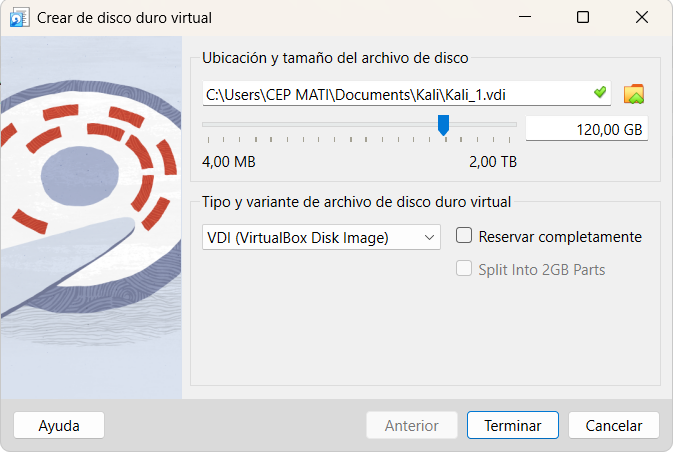

Inicia Kali, identifica el disc nou amb `lsblk`, crea-hi una partició i formata-la. Comprova que és el disc nou abans de formatar-lo. Assigna-li l’etiqueta `AUDITORIA` i crea-hi aquestes carpetes:

- `imatge/`
- `registres/`
- `resultats/`

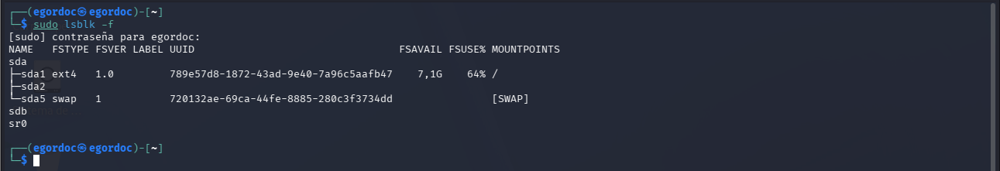
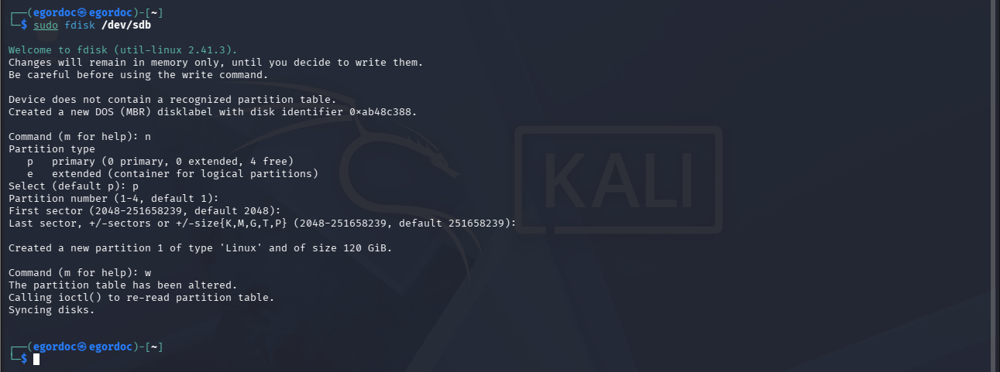
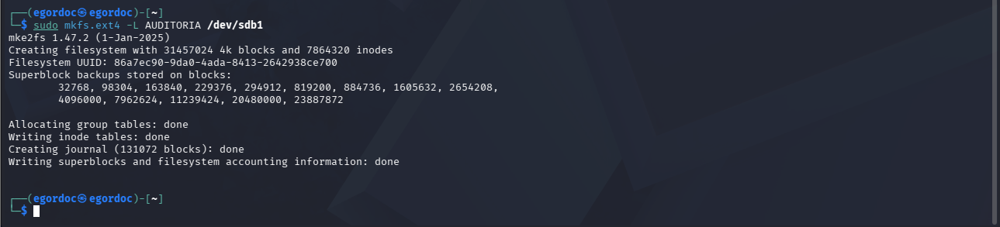
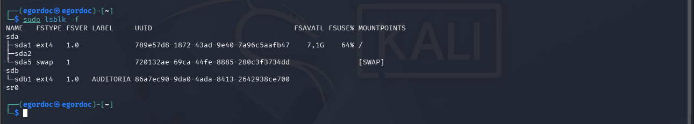
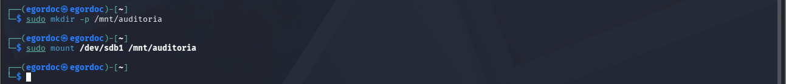
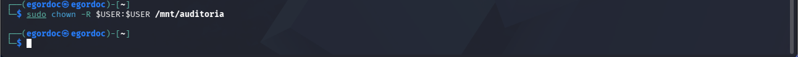
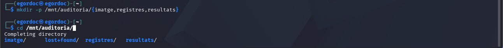

---

# 🧪 Evidència 1: Simulació, adquisició i anàlisi

## Pas 1: Crea, modifica i elimina fitxers

Al disc principal de Kali, crea una carpeta `~/cas_forense`.

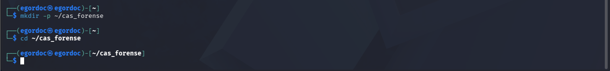

Dins d’aquesta carpeta:

- Crea un txt anomenat `secret_atac.txt` amb el text `INCIDENT_AULA_2026` i el teu nom.

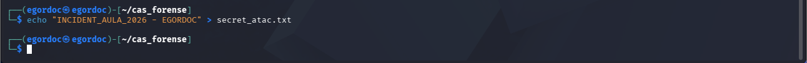

- Crea `document.txt` amb el contingut de "Lorem ipsum".

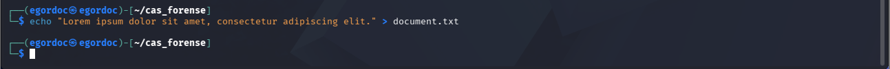

- Desa una imatge JPEG de prova.

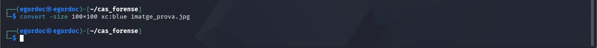

- Registra els hashes dels tres fitxers amb `sha256sum` i desa el registre al disc d’auditoria.

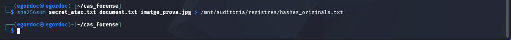

Després:

- Elimina `secret_atac.txt` amb `rm`.

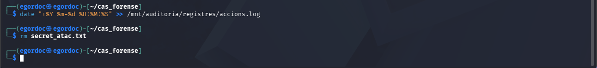

- Modifica el contingut de `document.txt` com creguis convenient.

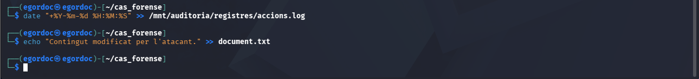

- Canvia’n els permisos amb `chmod`.

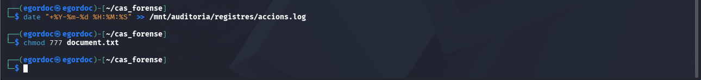

- Elimina la imatge JPEG.

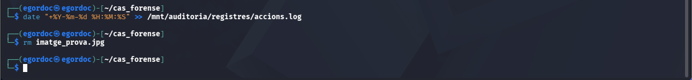

Anota les ordres i les hores al disc d’auditoria. Aquesta anotació servirà per comparar-la amb els resultats de la investigació.

## Pas 2: Simula una manipulació temporal

Crea `prova_temps.txt` dins de `~/cas_forense` i consulta’n les metadades:

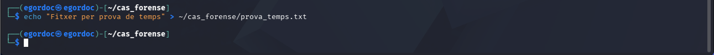


```bash
stat ~/cas_forense/prova_temps.txt
```

Modifica les dates:

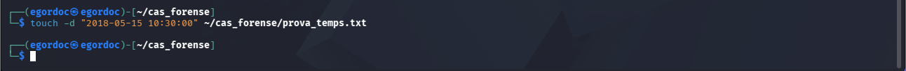

```bash
touch -d "2018-05-15 10:30:00" ~/cas_forense/prova_temps.txt
```

Torna a executar `stat` i desa els resultats anteriors i posteriors al disc d’auditoria.

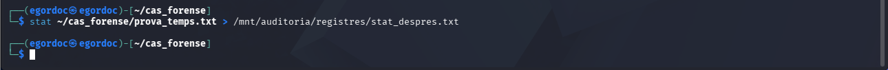

Identifica els canvis en Access, Modify i Change. Explica per què Change no és la data de creació.

## Pas 3: Desa els registres disponibles

Abans d’apagar Kali:

- Consulta `timedatectl` i desa’n el resultat.

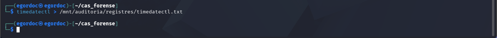

- Exporta els registres disponibles amb `journalctl`.

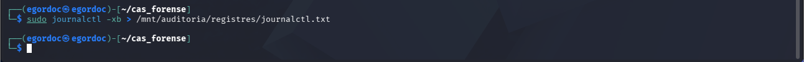

- Registra l’historial de les ordres de la pràctica.

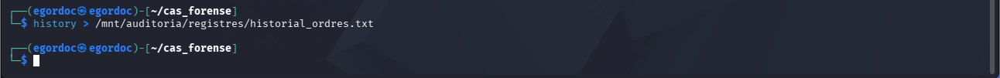

Desa aquests resultats a `auditoria/registres/`. Indica la data i hora de la recollida.

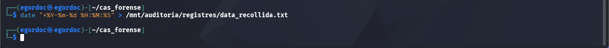

## Pas 4: Adquireix el disc principal amb `dd`

Apaga Kali i inicia la màquina virtual amb una ISO de Kali en mode Live.

La pots descarregar aquí: [Kali Linux Live (Google Drive)](https://drive.google.com/file/d/1nvYp9nuyudZA3fqD5oNzlsFEjwSLYe4M/view?usp=drive_link). És una versió del sistema operatiu que funciona sense instal·lació, no s’ha de confondre amb una ISO d’instal·lació.

Això ho fem perquè el sistema original no s’estigui executant mentre fem la còpia, a part que ens pot servir aquest Kali Live per fer còpies de qualsevol sistema operatiu.

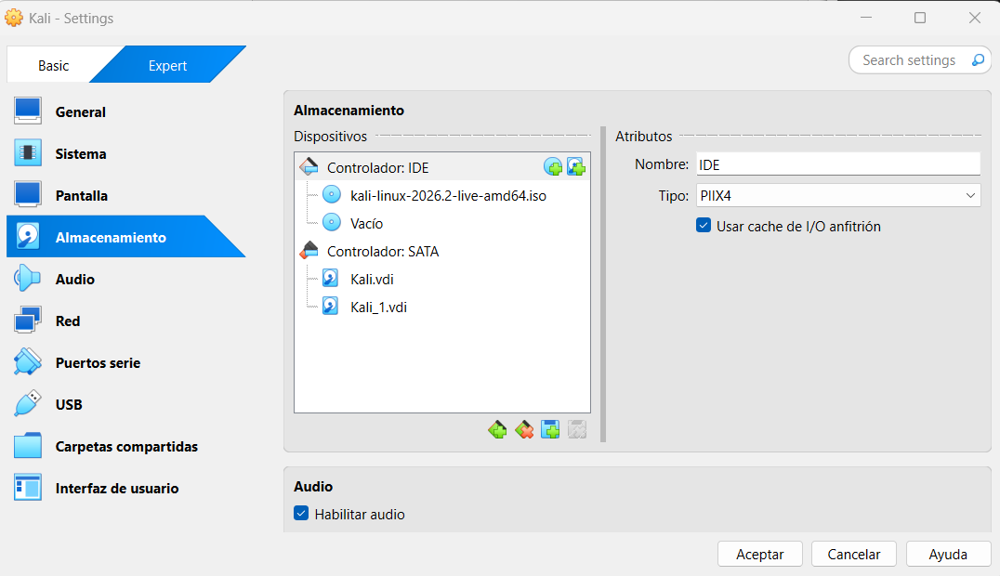

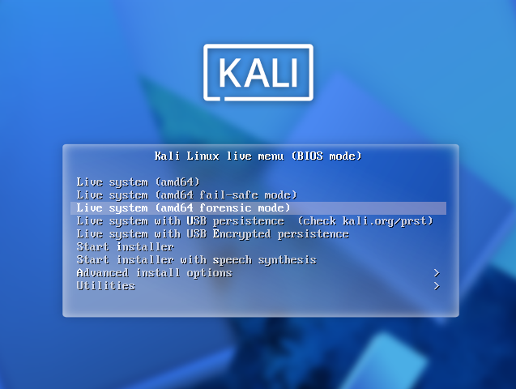

Identifica els dos discos amb `lsblk`. Mantén les particions del disc principal desmuntades i munta només el disc d’auditoria.

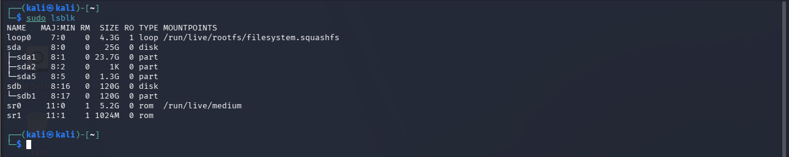

Utilitza `dd` per copiar el disc principal a:

`auditoria/imatge/kali.dd`

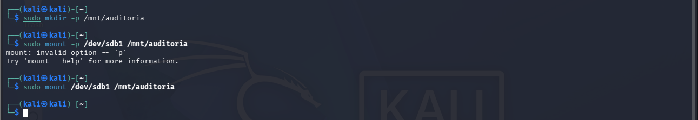

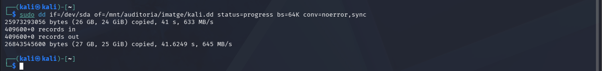

Documenta la comanda, el dispositiu d’origen, la destinació i el resultat. Els noms dels dispositius s’han de comprovar a cada màquina; no s’han de copiar a cegues.

Explica per què aquesta imatge pot contenir restes dels fitxers eliminats.

## Pas 5: Calcula el hash i analitza la imatge

Calcula el hash SHA-256 de `kali.dd` i desa’l al disc d’auditoria.

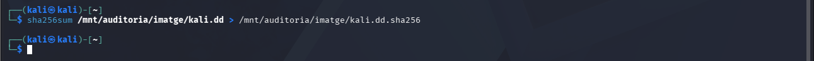

Torna a iniciar Kali des del disc principal. Analitza `kali.dd` amb Autopsy clàssic o The Sleuth Kit, sense muntar la imatge en mode d’escriptura.

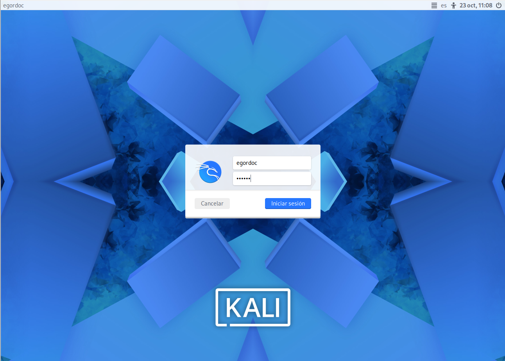

Busca:

- `document.txt` i el contingut modificat.
- Les metadades de `prova_temps.txt`.
- Les entrades eliminades que encara siguin identificables.

Utilitza també `strings` i `grep` per cercar `INCIDENT_AULA_2026`.

Finalment, utilitza PhotoRec per intentar recuperar la imatge JPEG. Desa els fitxers recuperats a `auditoria/resultats/` i compara el hash amb el registrat abans d’eliminar-la.

Documenta tant les recuperacions com els intents sense resultat.

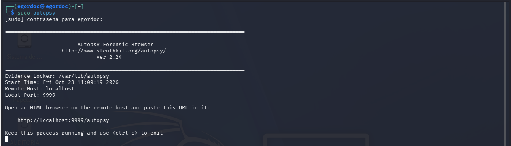

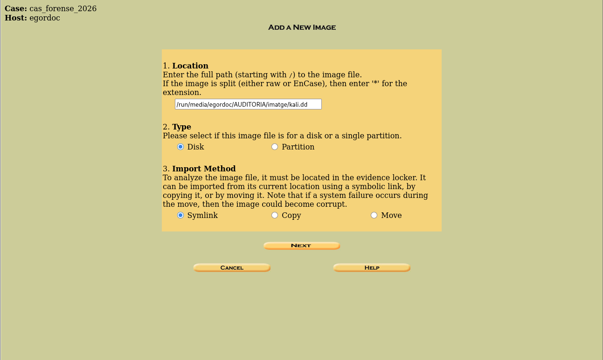

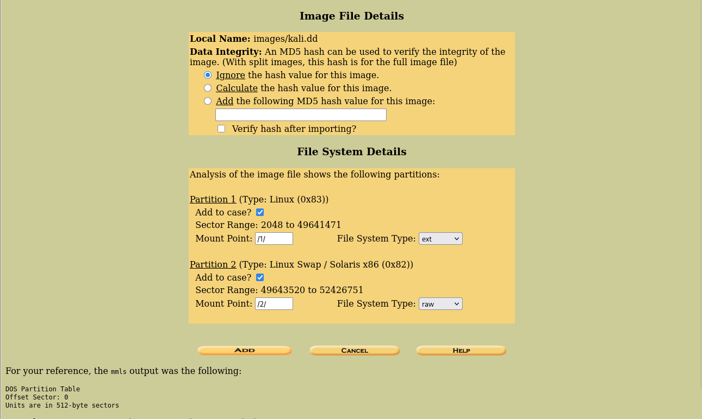

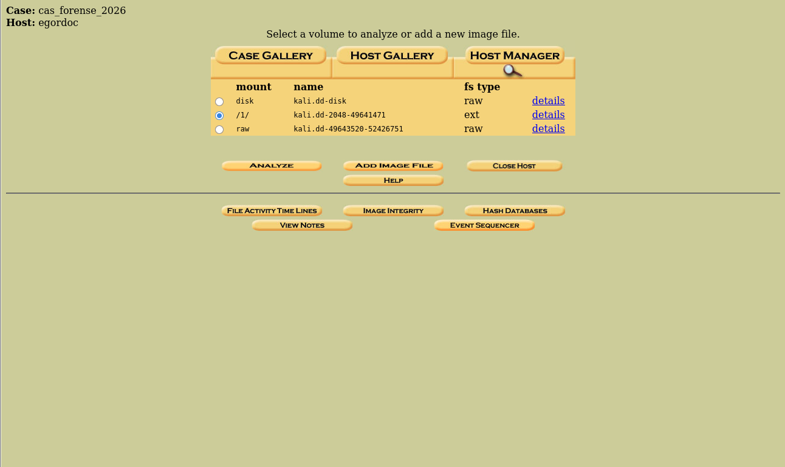

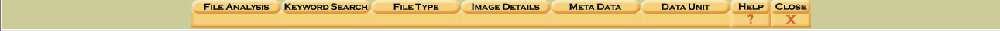

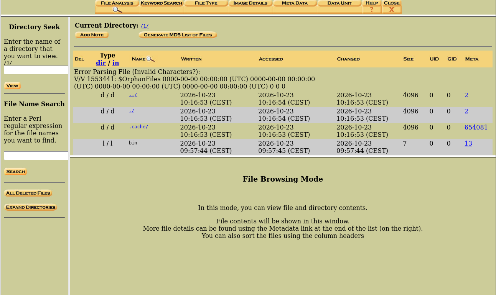

---

# 📝 Evidència 2: Reconstrucció i informe

## Pas 1: Construeix una línia de temps senzilla

Organitza per a totes les evidències:

- Data i hora.
- Acció observada.
- Font.
- Què es pot demostrar?
- Metadades, registres o contingut recuperat.

No confonguis les dates del fitxer `kali.dd` amb les dates dels fitxers que conté.

## Pas 2: Comprova la integritat

Torna a calcular el hash de `kali.dd` després de l’anàlisi i compara’l amb el primer.

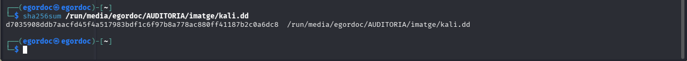

Explica què indica la coincidència o discrepància.

## Pas 3: Elabora l’informe i la cadena de custòdia

Inclou:

- Les accions simulades.
- La identificació dels discos i la comanda d’adquisició.
- El hash inicial i final.
- Les eines utilitzades.
- Les evidències trobades i les limitacions.
- La línia de temps.
- Tres mesures de prevenció o recuperació justificades pels resultats.
