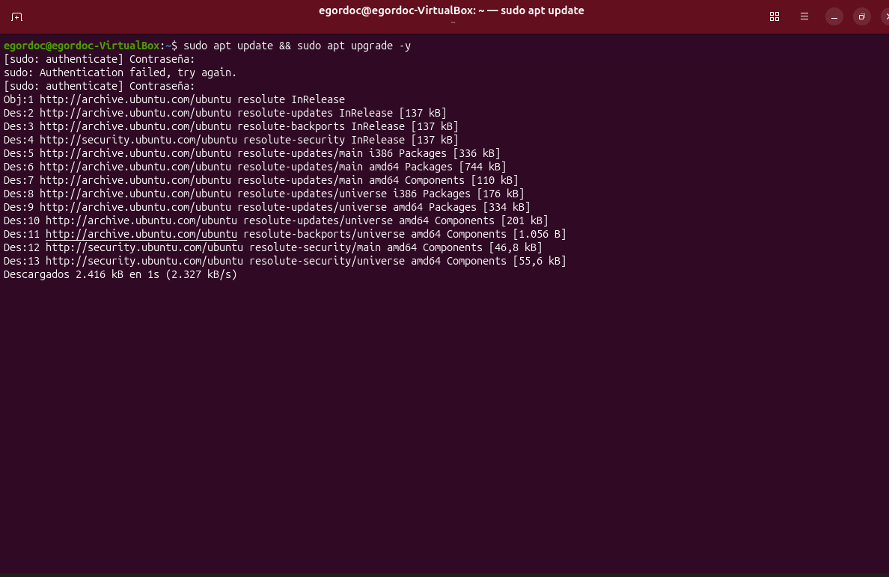
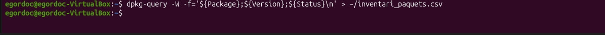
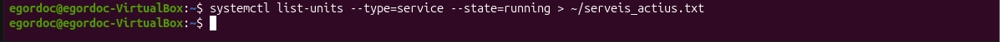
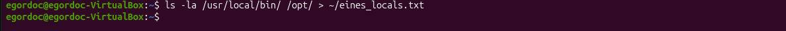
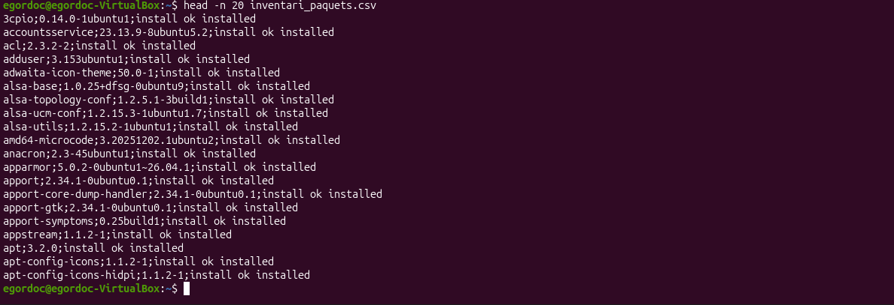
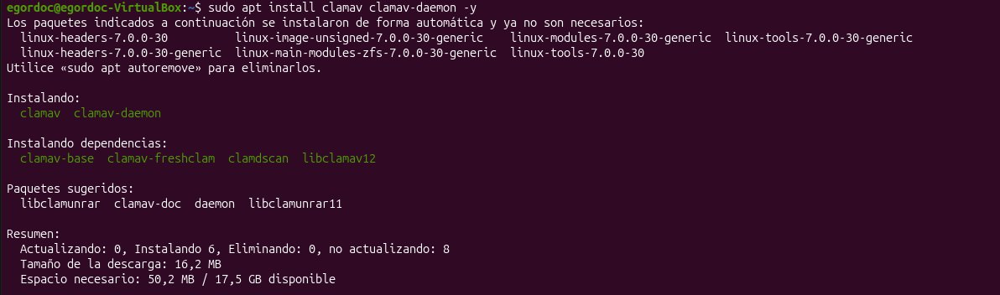
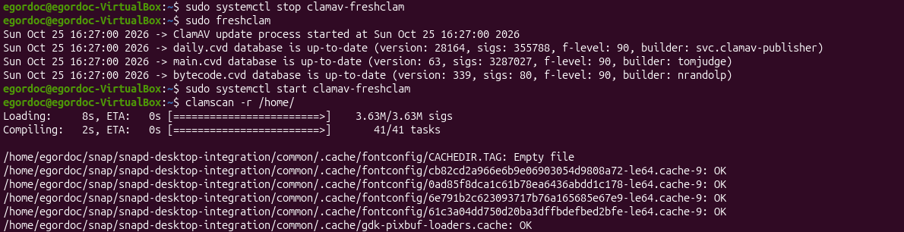

# 🛡️ CyberShield - Fase 1: Configuració i Auditoria de la Màquina Virtual Model

Aquest repositori conté la documentació tècnica i l'evidència del procés de preparació, auditoria i instal·lació de l'equip model (màquina virtual Ubuntu) per a l'agència de ciberseguretat **CyberShield**.

---

## 📑 Índex
1. [Preparació i Assignació de Recursos](#1-preparació-i-assignació-de-recursos)
2. [Actualització del Sistema](#2-actualització-del-sistema)
3. [Auditoria i Inventari del Sistema](#3-auditoria-i-inventari-del-sistema)
4. [Instal·lació del Programari Corporatiu](#4-instal·lació-del-programari-corporatiu)
5. [Configuració i Validació de les Eines](#5-configuració-i-validació-de-les-eines)

---

## 1. Preparació i Assignació de Recursos

Per garantir un rendiment òptim durant les tasques d'anàlisi de seguretat, gestió de dades i manteniment, s'ha creat una màquina virtual amb **Ubuntu Desktop** assignant els següents recursos de maquinari:

* **Nom de la VM:** `CyberShield-Master-VM`
* **Processador (vCPU):** 2 nuclis
* **Memòria RAM:** 4096 MB (4 GB)
* **Disc Dur:** 40 GB (Dynamic Allocation / VDI)
* **Xarxa:** Mode NAT (accés a Internet per a actualitzacions i repositoris)


*Captura de la configuració de la màquina virtual en l'hipervisor.*

---

## 2. Actualització del Sistema

Abans de procedir amb l'auditoria i la instal·lació de programari nou, s'han consultat els repositoris oficials i s'ha actualitzat tot el programari del sistema a la darrera versió disponible.

```bash
sudo apt update && sudo apt upgrade -y
```


*Execució de l'actualització del sistema via terminal.*

---

## 3. Auditoria i Inventari del Sistema

D'acord amb les ordres directes de l'agència, s'ha extret un inventari complet de l'estat inicial de la màquina model.

### 3.1. Llista de Paquets Instal·lats
S'ha generat un registre amb el format personalitzat extret mitjançant `dpkg-query`:

**Ordre executada:**
```bash
dpkg-query -W -f='${Package};${Version};${Status}\n' > inventari_paquets.csv
```
*Opció alternativa:*
```bash
apt list --installed > inventari_apt.txt
```


*Exemple de la sortida de la comanda dpkg-query.*

### 3.2. Serveis Actius en Segon Pla
S'han identificat els serveis que s'estan executant actualment en el sistema mitjançant `systemctl`:

**Ordre executada:**
```bash
systemctl list-units --type=service --state=running > serveis_actius.txt
```


*Llista de serveis en segon pla actius.*

### 3.3. Eines Específiques i Executables Locals
S'ha comprovat la presència d'executables d'administració o eines preinstal·lades als directoris `/usr/local/bin` i `/opt`:

**Ordre executada:**
```bash
ls -la /usr/local/bin /opt > eines_locals.txt
```


*Contingut dels directoris d'administració /usr/local/bin i /opt.*

---

## 4. Instal·lació del Programari Corporatiu

S'han descarregat i instal·lat les eines requerides per complir amb les especificacions de treball de CyberShield:

| Categoria | Eina Seleccionada | Descripció / Funció | Comanda d'Instal·lació |
| :--- | :--- | :--- | :--- |
| **Antivirus** | `ClamAV` | Detecció d'amenaces, fitxers i analitzador de seguretat. | `sudo apt install clamav clamav-daemon -y` |
| **Gestor d'Arxius** | `Midnight Commander` (`mc`) | Organització i gestió avançada de fitxers en terminal i entorn gràfic. | `sudo apt install mc -y` |
| **Recuperació de Dades** | `TestDisk` / `PhotoRec` | Recuperació de particions perdudes i fitxers esborrats. | `sudo apt install testdisk -y` |
| **Manteniment i Optimització** | `BleachBit` & `Stacer` | Neteja de fitxers temporals, optimització i monitorització de recursos. | `sudo apt install bleachbit stacer -y` |
| **Gestió d'Imatges i Particions** | `GParted` & `dd` | Gestió de particions i eines per a clonació de disc a baix nivell. | `sudo apt install gparted -y` |


*Procés d'instal·lació de paquets requerits.*

---

## 5. Configuració i Validació de les Eines

S'ha verificat el funcionament de cadascuna de les eines instal·lades:

1. **ClamAV:** S'ha actualitzat la base de dades de signatures (`freshclam`) i s'ha realitzat un escaneig de prova sobre el directori `/home`.
2. **Midnight Commander:** S'ha comprovat la navegació i operacions de fitxers a través de la interfície `mc`.
3. **Stacer / BleachBit:** S'ha executat una neteja inicial de la memòria cau del sistema i s'ha validat la monitorització de CPU/RAM.


*Execució de l'antivirus i verificació de funcionament.*

---

📌 **Propera fase:** Validat el funcionament de la màquina virtual model, es procedirà amb les proves de recuperació de dades, la generació de la imatge completa `.img` i la posterior restauració en maquinari físic.

