# 🔐 Evidències: Desplegament d'ofimàtica web segura i simulació de phishing

## 🎯 Objectiu

Instal·lar i protegir una suite d'ofimàtica web **Nextcloud** en un entorn virtualitzat amb Ubuntu, Apache, MariaDB i PHP. Aplicar el principi de mínim privilegi, configurar HTTPS i analitzar incidents de seguretat.

## 🛠️ Evidència 1: Instal·lació de Nextcloud i mínim privilegi

### Objectiu

Crear una base de dades exclusiva per a Nextcloud i un usuari amb permisos limitats per reduir els riscos en cas de vulnerabilitat.

### 1. Crear la base de dades i l'usuari

Accedim a MariaDB:

```bash
sudo mariadb -u root
```

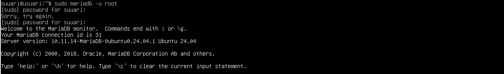

Executem les comandes SQL:

```sql
CREATE DATABASE nextcloud_db
CHARACTER SET utf8mb4
COLLATE utf8mb4_general_ci;

CREATE USER 'nc_user'@'localhost'
IDENTIFIED BY 'ContrasenyaSegura';

GRANT ALL PRIVILEGES ON nextcloud_db.*
TO 'nc_user'@'localhost';

EXIT;
```

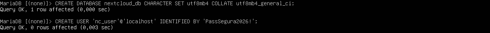

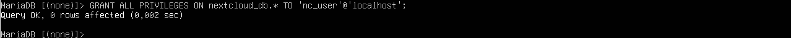

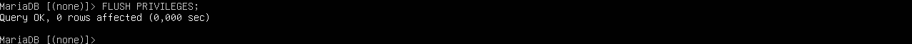

### 2. Instal·lar les extensions de PHP

```bash
sudo apt update
sudo apt install php-zip php-xml php-mbstring php-curl php-gd php-mysql php-intl php-bcmath php-gmp php-imagick unzip -y
```

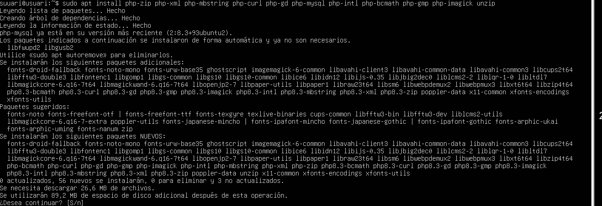

### 3. Descarregar i instal·lar Nextcloud

```bash
cd /tmp
wget https://download.nextcloud.com/server/releases/latest.zip
unzip latest.zip
sudo mv nextcloud /var/www/html/
sudo chown -R www-data:www-data /var/www/html/nextcloud
sudo chmod -R 755 /var/www/html/nextcloud
```

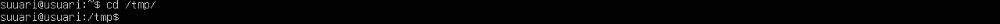

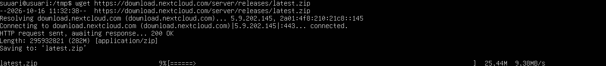


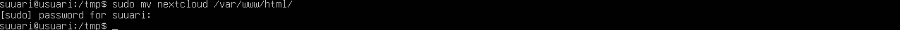

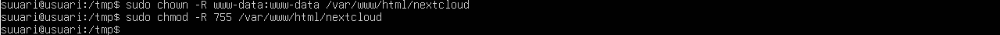

### 4. Comprovar els permisos de la base de dades

```bash
mariadb -u nc_user -p -e "SHOW DATABASES;"
```

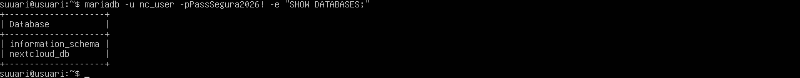

Introduïm la contrasenya de l'usuari. La sortida ha de mostrar només la base de dades assignada i les bases de dades del sistema necessàries per a MariaDB.

---

## 🔒 Evidència 2: HTTPS i configuració de Nextcloud

### Objectiu

Xifrar la comunicació entre el navegador i el servidor i afegir capçaleres de seguretat per reduir els riscos d'atacs web.

### 1. Activar els mòduls SSL i Headers

```bash
sudo a2enmod ssl headers
sudo a2ensite default-ssl
```

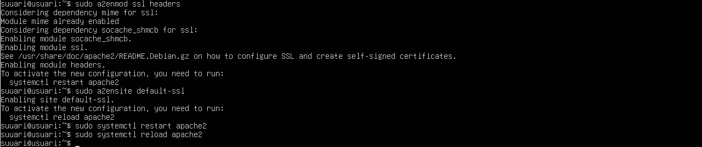

### 2. Configurar les capçaleres de seguretat

Obrim el fitxer de configuració:

```bash
sudo nano /etc/apache2/conf-available/security.conf
```

Afegim al final:

```apache
Header always set X-Frame-Options "SAMEORIGIN"
Header always set X-Content-Type-Options "nosniff"
```

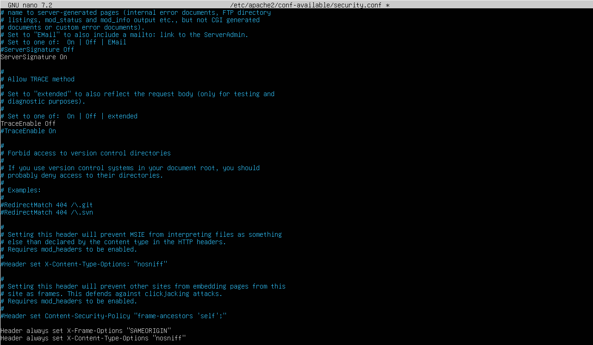

Activem la configuració i recarreguem Apache:

```bash
sudo a2enconf security
sudo apache2ctl configtest
sudo systemctl reload apache2
```

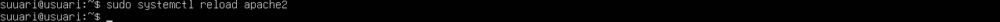

### 3. Configurar Nextcloud

Des de la VM Víctima, accedim al navegador:

```text
https://IP_DEL_SERVIDOR/nextcloud
```

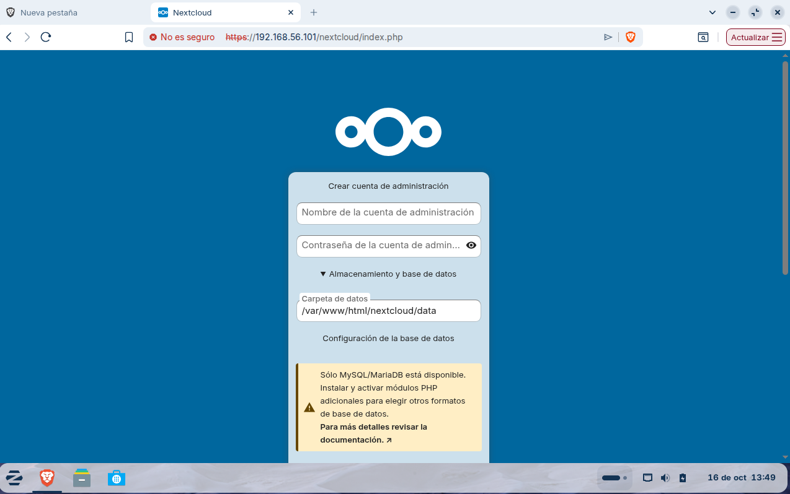

Si apareix l'avís del certificat autofirmat, comprovem que correspon al nostre servidor de proves abans de continuar.

Completem l'assistent amb les dades següents:

- **Usuari administrador:** `admin_nc`
- **Base de dades:** MySQL / MariaDB
- **Usuari de BD:** `nc_user`
- **Contrasenya:** la configurada anteriorment
- **Nom de la BD:** `nextcloud_db`
- **Servidor de BD:** `localhost`

Un cop instal·lat, creem un fitxer anomenat `document_corporatiu.txt`.

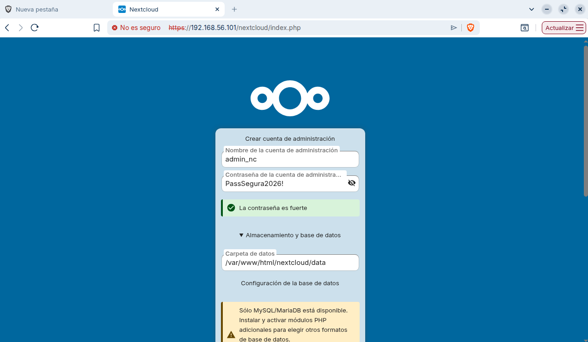

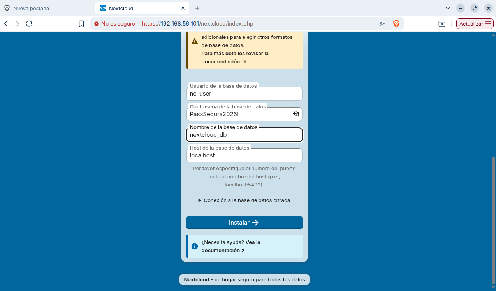

---

## 🕵️ Evidència 3: Resposta a incidents i anàlisi forense

### Objectiu

Aprendre a revocar sessions sospitoses i analitzar els registres del servidor per identificar accessos i possibles incidents de seguretat.

### 1. Revocar sessions actives

Des de Nextcloud:

1. Accedim a la icona de l'usuari.
2. Obrim **Paràmetres → Seguretat**.
3. Consultem la secció de dispositius i sessions.
4. Revocem les sessions desconegudes o sospitoses.

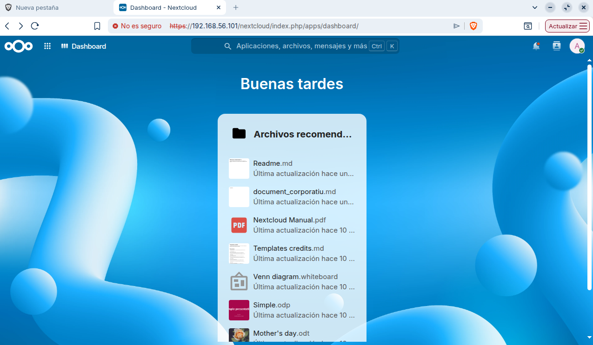

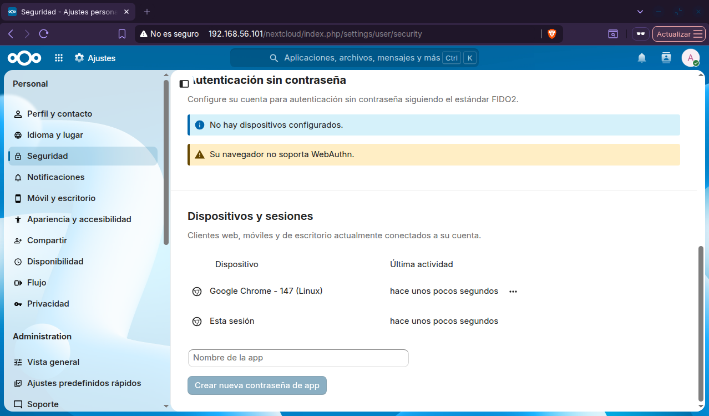

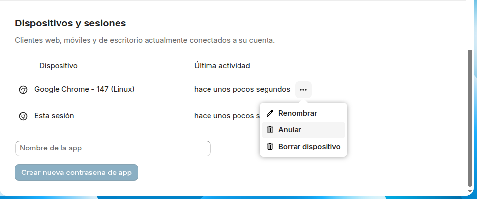

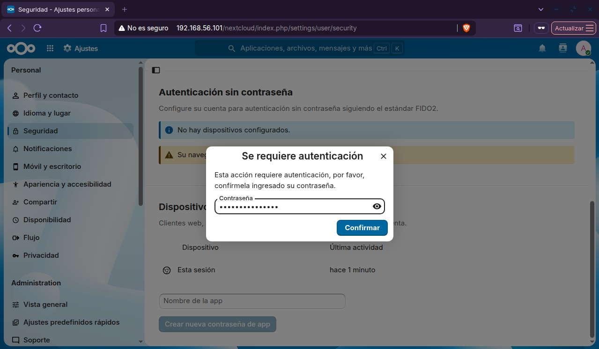

Aquesta acció ajuda a impedir que una sessió compromesa continuï activa.

### 2. Consultar els logs d'Apache

A la VM Servidor, executem:

```bash
sudo tail -n 15 /var/log/apache2/other_vhosts_access.log
```

Si les peticions no apareixen en aquest fitxer, consultem el registre general:

```bash
sudo tail -n 15 /var/log/apache2/access.log
```

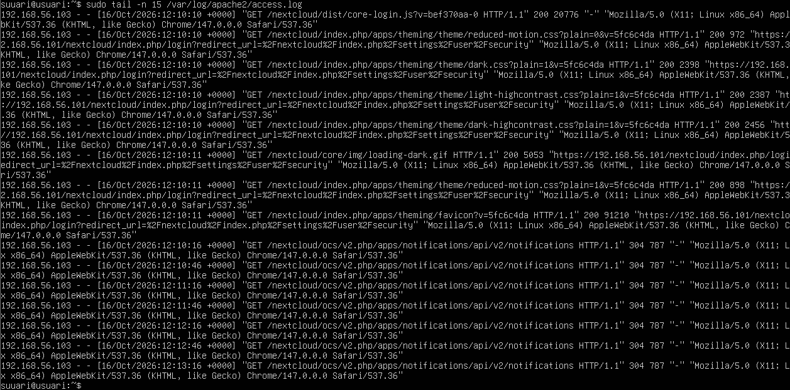

Cal identificar:

- **IP d'origen:** adreça de l'equip que fa la petició.
- **Data i hora:** moment de l'accés.
- **Mètode HTTP:** `GET` o `POST`.
- **Codi de resposta:** per exemple, `200`, `302` o `403`.
- **Recurs sol·licitat:** pàgina o fitxer consultat.

---

## 📝 Conclusions

Aquesta pràctica permet desplegar una suite d'ofimàtica web i aplicar mesures bàsiques de ciberseguretat. El mínim privilegi a MariaDB, el xifratge HTTPS, les capçaleres de seguretat i l'anàlisi dels logs ajuden a reduir els riscos i a respondre davant possibles incidents.

**Important:** totes les simulacions s'han de realitzar en un entorn de proves autoritzat i aïllat.
