# Guia pas a pas: administració d'usuaris i permisos

Aquesta guia pas a pas permet completar tots els apartats de la pràctica d'administració d'usuaris i permisos en **Windows 10** i **Kali Linux**. Substitueix `elteunom` pel teu nom real en totes les ordres i usuaris (per exemple, `isaacclient` i `isaacadmin`).

---

## Apartat 1. Investiga els usuaris existents

### Windows 10

1. **Identifica l'usuari actual:** Obre la consola de comandes (`cmd`) i executa:

```cmd
whoami
```

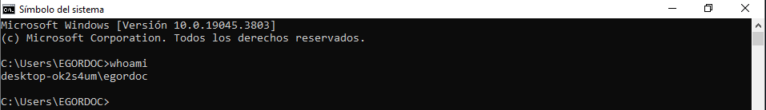

2. **Llista tots els usuaris locals:**

```cmd
net user
```

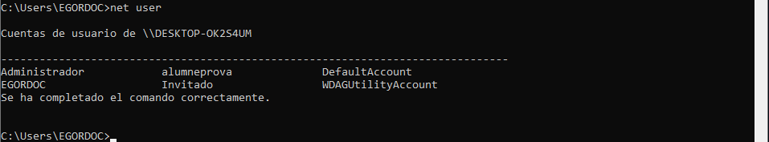

3. **Localitza els comptes gràficament:** Prem `Win + R`, escriu `lusrmgr.msc` i prem Enter. A la carpeta **Usuarios** veuràs tots els comptes.

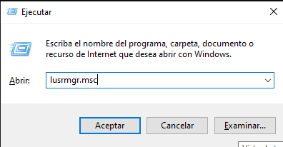
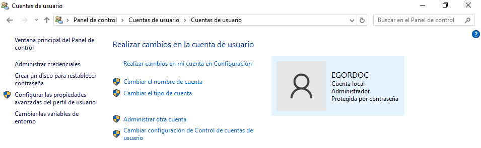

4. **Diferencia usuaris creats i del sistema:**
   - *Creats per tu:* Els que tenen el teu nom o els utilitzats per a la instal·lació.
   - *Creats pel sistema:* Comptes com `Administrador`, `Invitado`, `DefaultAccount`, `WDAGUtilityAccount`.


5. **Comprova comptes desactivats:** A `lusrmgr.msc`, fes doble clic sobre qualsevol compte. Si la casella *"La cuenta está deshabilitada"* està marcada (o té una fletxa cap avall a la icona), el compte està desactivat.

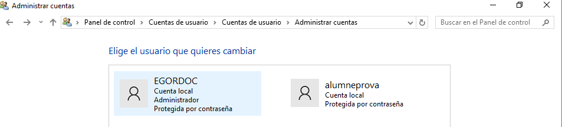

6. **Localitza el teu SID:** Executa a la consola:

```cmd
wmic useraccount where name='%username%' get name,sid
```

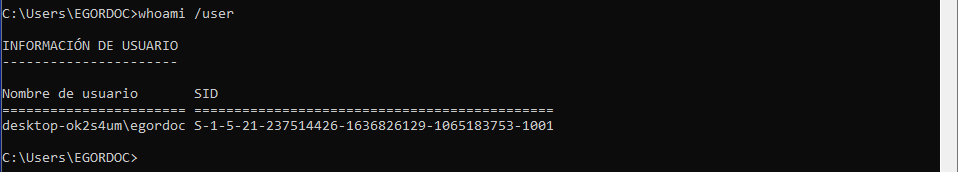

7. **Comptes predeterminats:** `Administrador`, `Invitado`, `DefaultAccount`, `WDAGUtilityAccount`.

### Kali Linux

1. **Identifica l'usuari actual:**

```bash
whoami
```

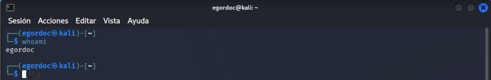

2. **Consulta el seu UID:**

```bash
id -u
```

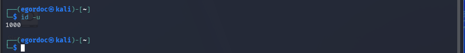

3. **Identifica els grups de l'usuari:**

```bash
groups
```

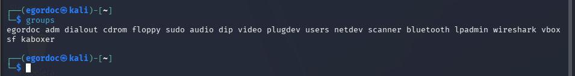

4. **Llista tots els usuaris existents:**

```bash
cut -d: -f1 /etc/passwd
```

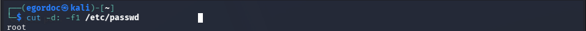

5. **Localitza el compte root:** Executa `grep '^root:' /etc/passwd`. Veuràs que té UID `0`.

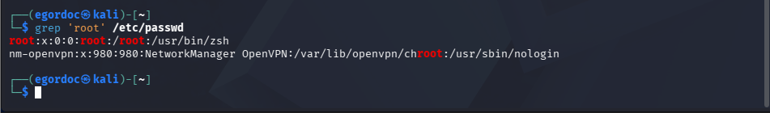

6. **Comptes de sistema (no persones):** Comptes com `daemon`, `bin`, `sys`, `nobody`, `www-data` s'utilitzen per a serveis i dimonis del sistema.

---

## Apartat 2. Investiga els grups predeterminats

### Windows 10

1. **Consulta tots els grups locals:**

```cmd
net localgroup
```

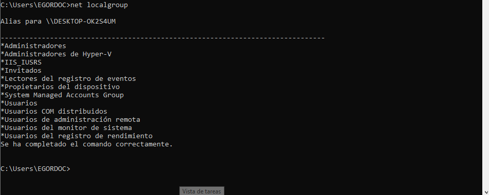

2. **Localitza i comprova el grup d'Administradors:**

```cmd
net localgroup Administradores
```

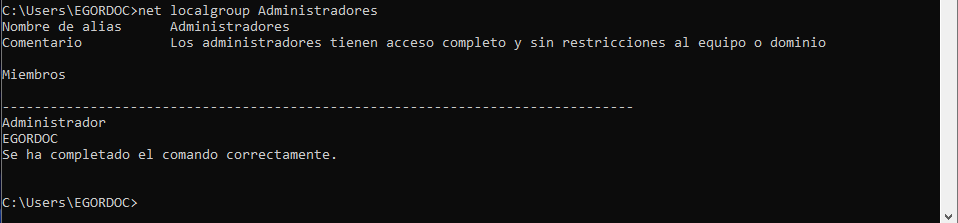

3. **Localitza el grup d'usuaris estàndard:**

```cmd
net localgroup Usuarios
```

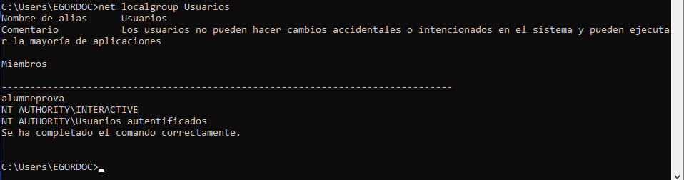

4. **Localitza el grup d'Escriptori Remot:**

```cmd
net localgroup "Usuarios de escritorio remoto"
```

5. **Identifica els grups del teu usuari:** Executa `whoami /groups`.

6. **Verifica privilegis administratius:** Si a la sortida de `whoami /groups` veus el grup `BUILTIN\Administradores`, l'usuari disposa de privilegis d'administració.

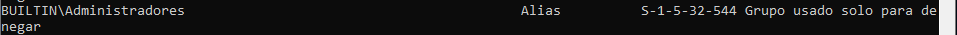

### Kali Linux

1. **Consulta els grups existents:**

```bash
cut -d: -f1 /etc/group
```

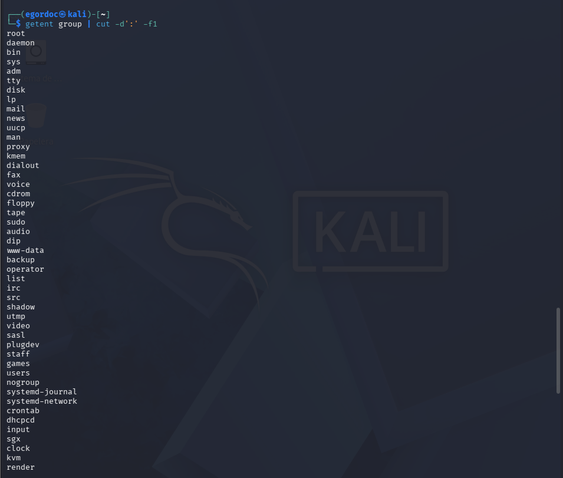
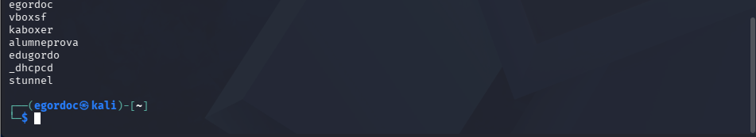

2. **Identifica els grups del teu usuari:**

```bash
id
```


3. **Grup d'elevació de privilegis (sudo):** El grup `sudo` és el que permet executar comandes com a root.

4. **Membres del grup sudo:**

```bash
getent group sudo
```

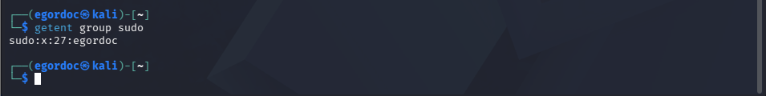

5. **Altres grups del sistema:** Exemples: `audio`, `video`, `cdrom`, `dialout`.

---

## Apartat 3. Crea un usuari de treball

### Windows 10

*Suposem que l'usuari es diu `isaacclient`.*

1. **Crea l'usuari local i assigna contrasenya:** Obre PowerShell/CMD com a Administrador i executa:

```cmd
net user isaacclient Contrasenya123! /add
```

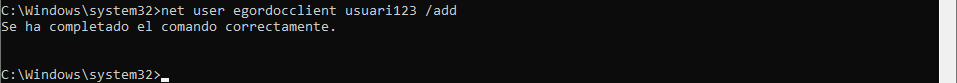

2. **Comprova que està habilitat:**

```cmd
net user isaacclient
```

*Verificació:* Comprova que a la sortida posi `Cuenta activa: Sí`.

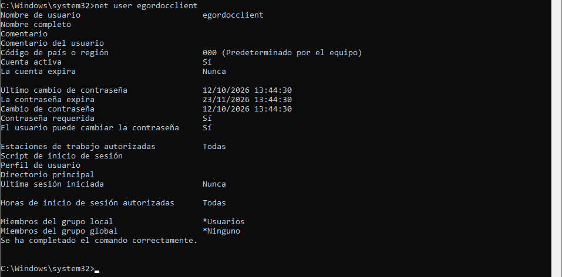

3. **Verifica que no té privilegis administratius:** Executa `net localgroup Administradores`. L'usuari `isaacclient` no hi ha de figurar.

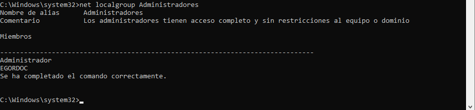

4. **Identifica el seu SID:**

```cmd
wmic useraccount where name='isaacclient' get sid
```

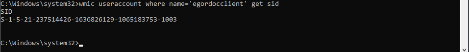

5. **Comprova els seus grups:** Executa `net user isaacclient` i revisa la secció "Pertenencias a grupos locales" (per defecte només serà `*Usuarios`).

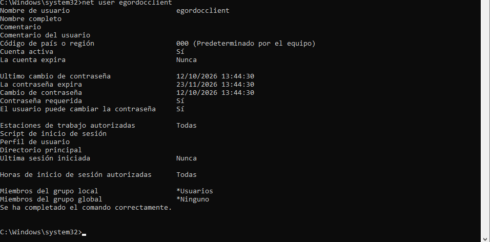

### Kali Linux

1. **Crea l'usuari client i assigna contrasenya:**

```bash
sudo adduser isaacclient
```

*(Introdueix la contrasenya quan la demani i confirma la informació).*

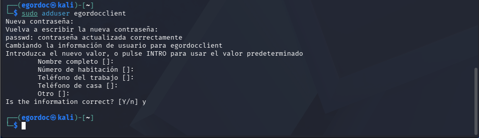

2. **Comprova el directori personal:** Executa `ls -ld /home/isaacclient`. Ha d'existir el directori `/home/isaacclient`.

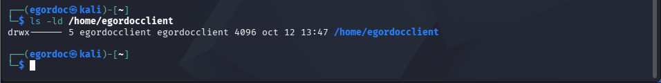

3. **Identifica el seu UID i grup principal:**

```bash
id isaacclient
```

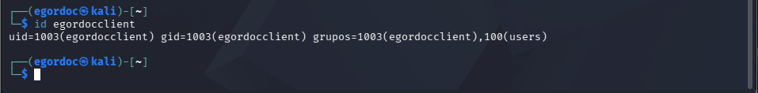

4. **Comprova altres grups i privilegis:** Veuràs el seu UID (normalment ≥ 1000) i el seu GID principal. Executa `groups isaacclient` per confirmar que no pertany al grup `sudo`.

---

## Apartat 4. Crea un grup local

### Windows 10

1. **Crea el grup local:**

```cmd
net localgroup GrupClients /add
```

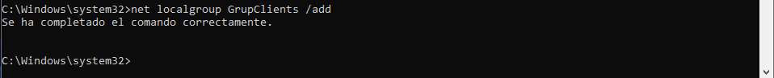

2. **Afegeix l'usuari client al grup:**

```cmd
net localgroup GrupClients isaacclient /add
```

*Verificació:* Executa `net localgroup GrupClients` per veure que `isaacclient` apareix com a membre.

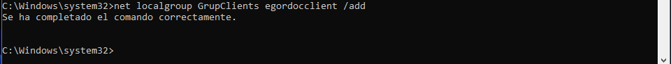
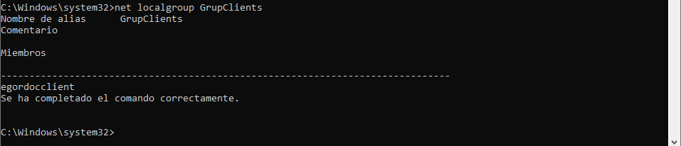

### Kali Linux

1. **Crea el grup:**

```bash
sudo groupadd ClientsLinux
```

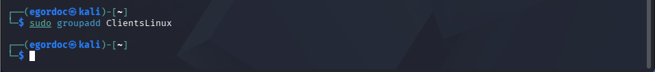

2. **Afegeix l'usuari client:**

```bash
sudo usermod -aG ClientsLinux isaacclient
```

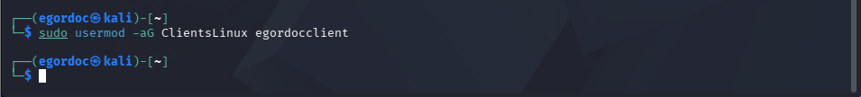

3. **Comprova la pertinença:**

```bash
getent group ClientsLinux
```

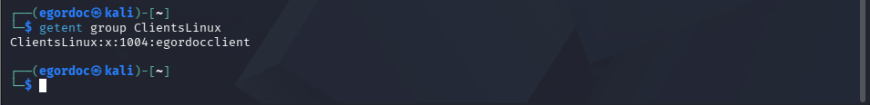

4. **Verifica en una nova sessió:** Obre un terminal, canvia d'usuari amb `su - isaacclient` i executa `groups`. Confirmaràs que `ClientsLinux` apareix a la llista.

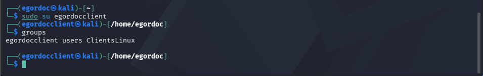

---

## Apartat 5. Separa el compte de treball del compte d'administració

### Windows 10

1. **Crea l'usuari admin:**

```cmd
net user isaacadmin ContrasenyaAdmin456! /add
```

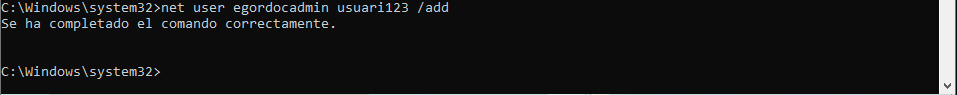

2. **Concedeix privilegis administratius:**

```cmd
net localgroup Administradores isaacadmin /add
```

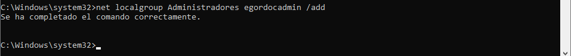

3. **Comprova a quins grups pertany:** Executa `net user isaacadmin`. Ha de figurar a `*Administradores` i `*Usuarios`.

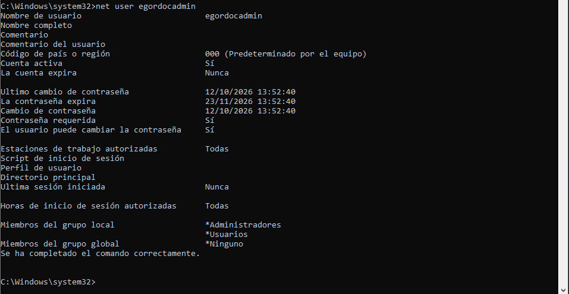

### Kali Linux

1. **Crea l'usuari admin:**

```bash
sudo adduser isaacadmin
```

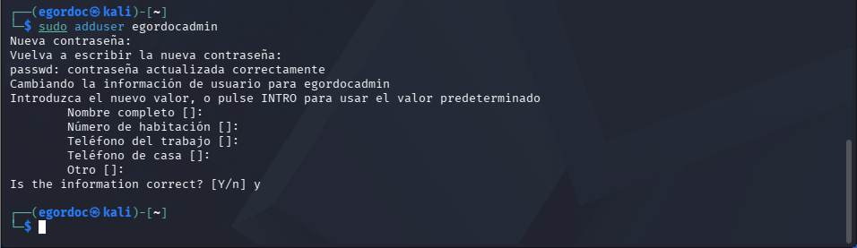

2. **Concedeix capacitats d'elevació (sudo):**

```bash
sudo usermod -aG sudo isaacadmin
```

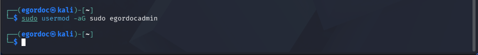

3. **Comprova els seus grups:** Executa `groups isaacadmin`. Ha de mostrar el grup `sudo`.

---

## Apartat 6. Comprova el principi de mínim privilegi

### Windows 10

1. **Inicia sessió amb `isaacclient`.**

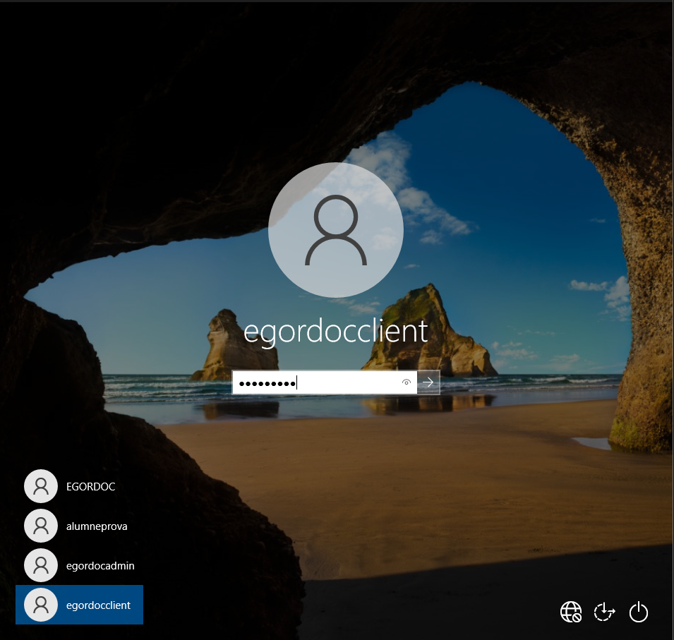

2. **Intenta canviar una configuració:** Intenta obrir la directiva de seguretat (`secpol.msc`) o instal·lar un programa. Veuràs una finestra d'UAC que demana credencials d'administrador.

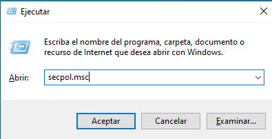
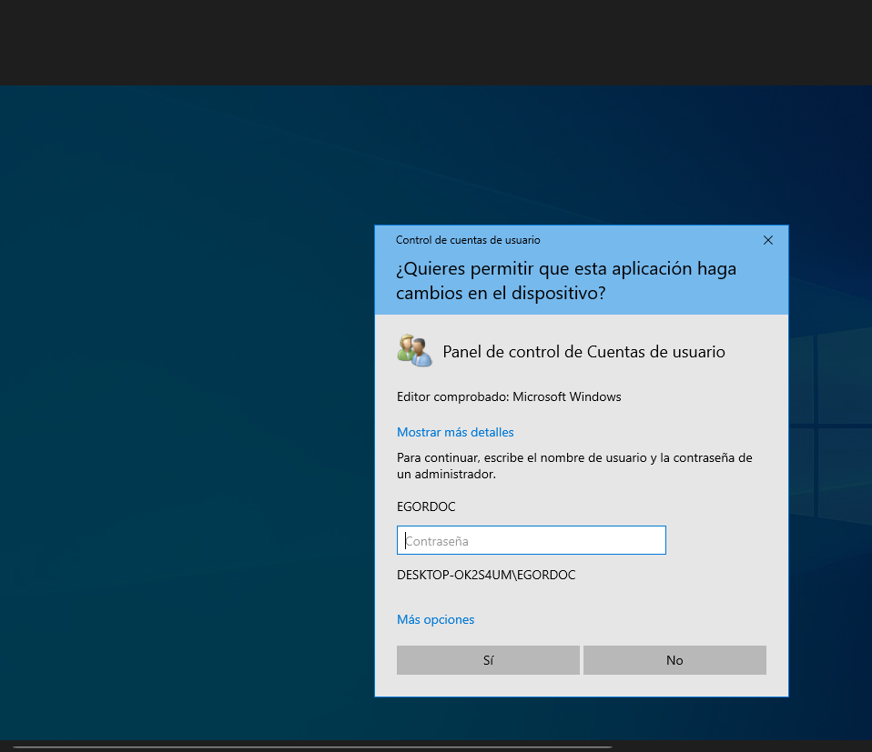

3. **Cancel·la l'elevació de privilegis:** Fes clic a "Cancelar". Veuràs que l'acció es denega, però pots continuar utilitzant l'equip per a tasques diàries (navegar, crear documents).

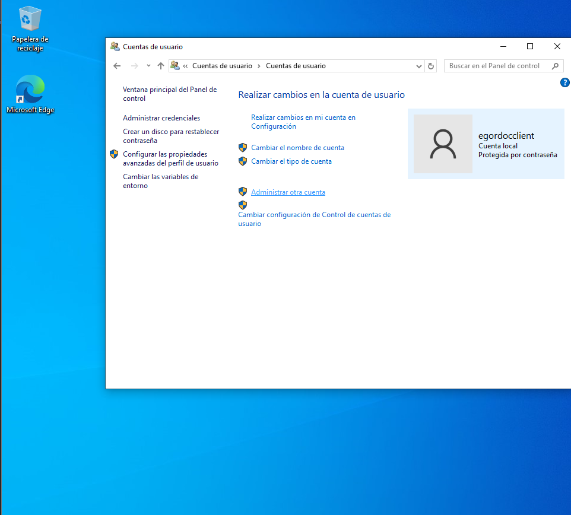

4. **Repeteix amb `isaacadmin`:** Tanca sessió i entra amb `isaacadmin`. Quan intentis fer la mateixa operació, només caldrà confirmar el diàleg d'UAC (o introduir la contrasenya d'admin) per poder realitzar el canvi.

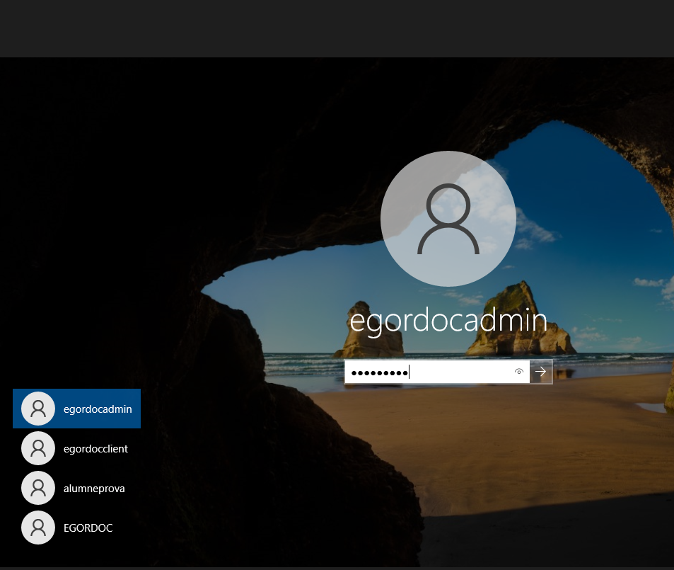

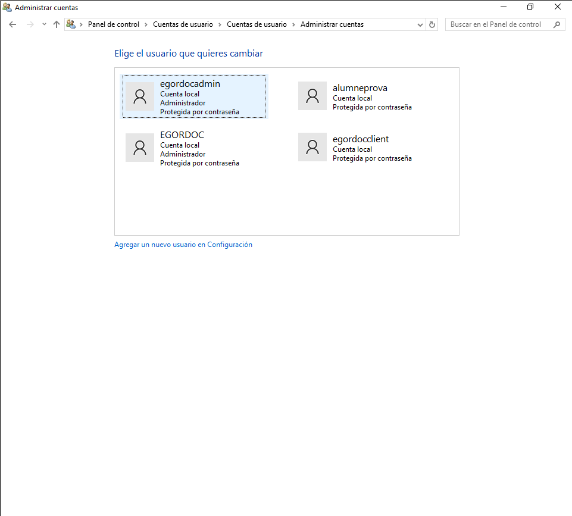

### Kali Linux

1. **Inicia sessió/canvia a `isaacclient`:** `su - isaacclient`.

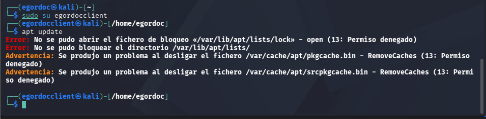

2. **Intenta executar una tasca de root:**

```bash
apt update
```

*Verificació:* El sistema retornarà un error de permisos (`Permission denied` / `Could not open lock file`).


3. **Inicia sessió/canvia a `isaacadmin`:** `su - isaacadmin`.


4. **Executa l'operació amb elevació:**

```bash
sudo apt update
```

Introdueix la contrasenya de `isaacadmin`. L'operació s'executarà correctament.

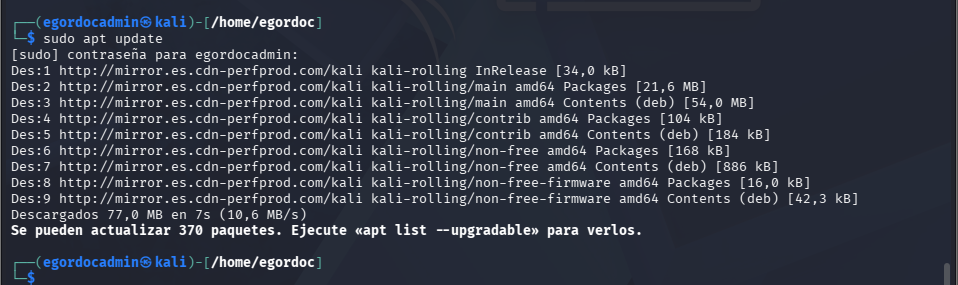

---

## Apartat 7. Investiga els perfils locals de Windows

1. **Inicia sessió com a `isaacclient`.**


2. **Localitza el perfil:** La ruta és `C:\Users\isaacclient`.

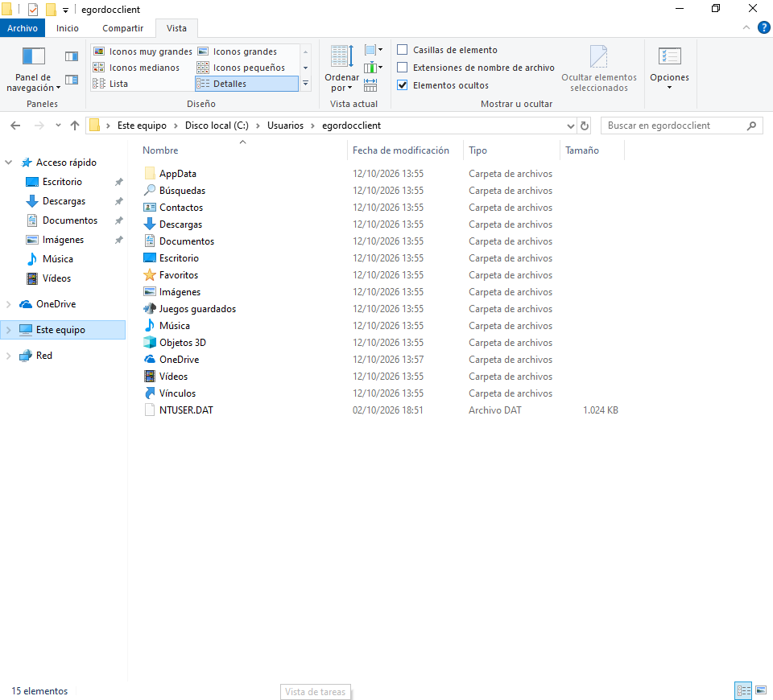

3. **Identifica les carpetes principals:** Dins trobaràs `Escritorio`, `Documentos`, `Descargas` i `Imágenes`.


4. **Activa elements ocults:** A l'Explorador de fitxers, ves a la pestanya **Vista** i marca la casella **Elementos ocultos**.

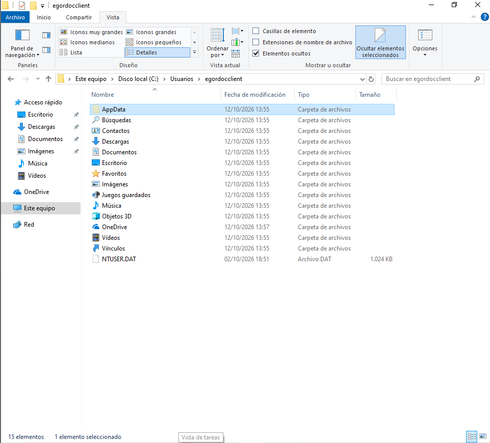

5. **Localitza AppData:** Veuràs la carpeta amagada `C:\Users\isaacclient\AppData`.


6. **Tanca la sessió i entra com a `isaacadmin`.**


7. **Comprova el seu propi perfil:** Revisa `C:\Users\isaacadmin` (té les seves pròpies carpetes independents).

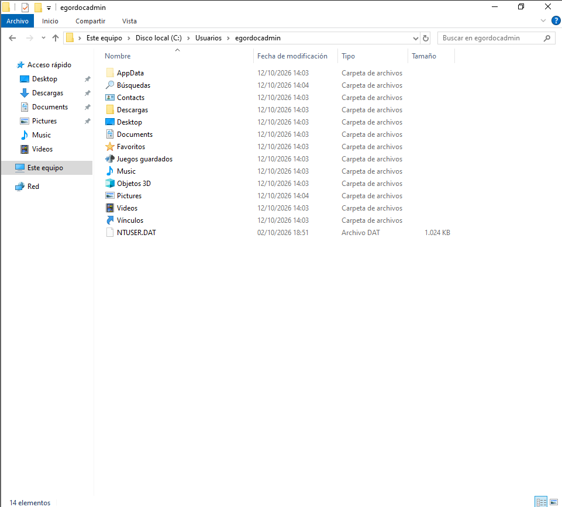

8. **Localitza el perfil de client:** Des de l'administrador, navega fins a `C:\Users\isaacclient`. Quan intentis entrar-hi, el sistema et demanarà confirmació per obtenir permisos d'accés.

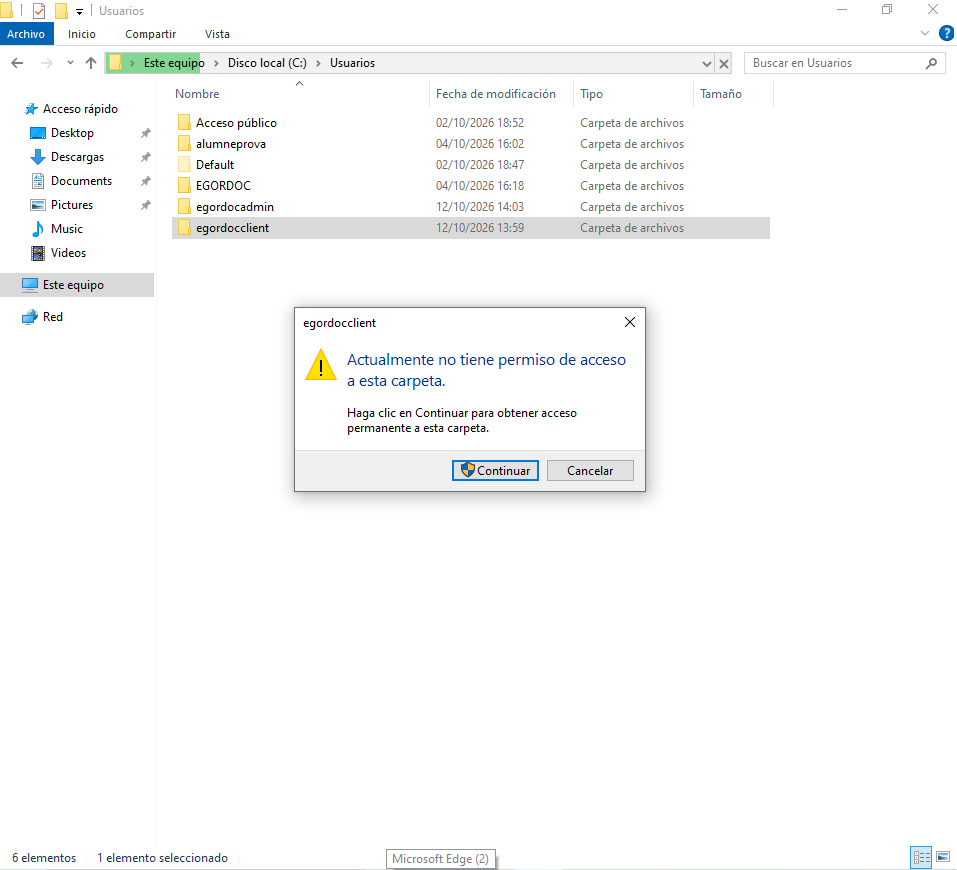

---

## Apartat 8. Investiga els directoris personals de Kali Linux

1. **Inicia sessió com a `isaacclient`.**


2. **Identifica el directori personal:**

```bash
echo $HOME
```

*(Retorna `/home/isaacclient`)*.


3. **Mostra fitxers i directoris ocults:**

```bash
ls -la ~
```

*(S'observaran fitxers com `.bashrc` o `.profile`)*.


4. **Explora els altres directoris personals:** Executa `ls -l /home` per veure les carpetes dels altres usuaris.


5. **Inicia sessió com a `isaacadmin` / root:**
   - El directori de `isaacadmin` és `/home/isaacadmin`.
   - Si entres com a `root`, el seu directori personal no està a `/home`, sinó directament a `/root`.


---

## Apartat 9. Protegeix informació del perfil

### Windows 10

1. **Sessió amb `isaacclient`.**


2. **Crea la carpeta i el fitxer:**

```cmd
mkdir C:\Users\isaacclient\Documents\Privat
echo "Hola" > C:\Users\isaacclient\Documents\Privat\document.txt
```


3. **Propietats de seguretat:** Fes clic dret sobre la carpeta `Privat` > **Propiedades** > pestanya **Seguridad**.


4. **Identifica propietari i permisos:** Fes clic a **Opciones avanzadas**.
   - *Propietari:* `isaacclient`.
   - *Permisos:* Observa si els permisos indiquen "Heredado de" (`C:\Users\isaacclient\Documents`).
   - Veuràs que `isaacclient` té *Control total*, però els usuaris del grup *Administradores* també hi tenen accés.


### Kali Linux

1. **Sessió amb `isaacclient`.**


2. **Crea carpeta i document:**

```bash
mkdir ~/privat
echo "Text privat" > ~/privat/document.txt
```


3. **Consulta els permisos actuals:**

```bash
ls -ld ~/privat
```


4. **Restringeix l'accés només al propietari:**

```bash
chmod 700 ~/privat
```

*Verificació:* `ls -ld ~/privat` ha de mostrar permisos `drwx------`.


5. **Comprova amb un altre usuari estàndard:** Obre un terminal i canvia a un altre usuari normal:

```bash
cd /home/isaacclient/privat
```

*(El sistema denegarà l'accés amb un error `Permission denied`)*.


6. **Torna a `isaacclient`:** Comprova que pots continuar accedint-hi (`ls -l ~/privat`).

---

## Apartat 10. Configura la seguretat dels comptes de Windows

1. **Obre les Directives de Seguretat Local:** Prem `Win + R`, escriu `secpol.msc` i prem Enter. *(Cal executar-ho com a administrador)*.

2. **Navega fins a les directives de compte:**
   - Fes clic a **Directivas de cuenta** > **Directiva de contraseñas**.

3. **Configura la política de contrasenyes:**

   

   - **Longitud mínima de la contraseña:** Fes-hi doble clic i estableix, per exemple, `10` caràcters.
   - **Historial de contraseñas:** Estableix un valor (ex. recordar les últimes `5` contrasenyes).
   - **Las contraseñas deben cumplir los requisitos de complejidad:** Configura-ho com a **Habilitado**.

4. **Configura la política de bloqueig de comptes:**

   

   - Navega a **Directivas de cuenta** > **Directiva de bloqueo de cuentas**.
   - **Umbral de bloqueo de cuentas:** Estableix, per exemple, `3` intents fallits.
   - *(El sistema s'oferirà a ajustar automàticament la durada del bloqueig i la finestra de restabliment).*

5. **Comprova que s'aplica la configuració:** Obre la consola (`cmd`) com a Administrador i executa:

```cmd
gpupdate /force
```

*Verificació:* El missatge de la consola ha d'indicar que la directiva de l'usuari i de l'equip s'han actualitzat correctament.


6. **Revisa els comptes `isaacclient` i `isaacadmin`:** Intenta canviar la contrasenya d'un d'ells per una de simple (ex. `1234`) des de la consola o la configuració i comprova que Windows la rebutja per no complir els requisits de complexitat o longitud.


