<!-- ==================== CAPÇALERA ==================== -->

<div align="center">

# 🛡️ SOC | LAN CORPORATIVA

### K-SIX SOLUTIONS · CYBERSECURITY LAB

**PLANIFICAR · CONNECTAR · PROTEGIR**


**NAHUEL G · EDU G · MARC J · ALEXIS T**

</div>

---

## 🧭 Índex del projecte

1. [Introducció](#introduccio)
2. [Disseny de la infraestructura](#infraestructura)
3. [Adreçament lògic de la LAN](#adreçament)
4. [Encapsulació de la informació](#encapsulacio)
5. [Evidències de Cisco Packet Tracer](#evidencies)
6. [Fases pràctiques](#fases-practiques)
7. [Conclusió](#conclusio)

---

<a id="introduccio"></a>

<h2 align="center">🎯 01 · INTRODUCCIÓ</h2>

K-SIX Solutions vol muntar una xarxa local (LAN) per al seu **Centre d'Operacions de Seguretat (SOC)**, on es puguin analitzar mostres de programari maliciós i amenaces de xarxa en un entorn controlat.

En aquesta memòria es documenta el disseny físic i lògic de la xarxa, l'adreçament IPv4, la configuració del servei DHCP i el recorregut de les dades durant l'encapsulació. Les fases 4 (resolució d'incidències) i 5 (elaboració d'un cable Ethernet) es duen a terme presencialment a l'aula i al taller.

### 🧰 Equips previstos a la planta

<div align="center">
<table align="center">
  <tr>
    <th align="center">Equipament</th>
    <th align="center">Quantitat prevista</th>
    <th align="center">Representació a Packet Tracer</th>
  </tr>
  <tr>
    <td align="center">Servidor Sandbox</td>
    <td align="center">1</td>
    <td align="center">1 servidor</td>
  </tr>
  <tr>
    <td align="center">Ordinadors de sobretaula</td>
    <td align="center">30</td>
    <td align="center">3 PCs</td>
  </tr>
  <tr>
    <td align="center">Portàtils Wi-Fi</td>
    <td align="center">20</td>
    <td align="center">2 laptops</td>
  </tr>
  <tr>
    <td align="center">Servidor d'emulació de xarxa</td>
    <td align="center">1</td>
    <td align="center">1 servidor</td>
  </tr>
  <tr>
    <td align="center">Router de sortida a Internet</td>
    <td align="center">1</td>
    <td align="center">1 router</td>
  </tr>
  <tr>
    <td align="center">Switch central</td>
    <td align="center">1</td>
    <td align="center">1 switch</td>
  </tr>
  <tr>
    <td align="center">Punts d'accés Wi-Fi</td>
    <td align="center">2</td>
    <td align="center">2 punts d'accés</td>
  </tr>
</table>
</div>

> **Nota:** a la simulació s'ha representat una mostra reduïda dels ordinadors i portàtils per fer més clara la topologia. El disseny lògic contempla el nombre total d'equips indicat.

---

<a id="infraestructura"></a>

<h2 align="center">🧱 02 · DISSENY DE LA INFRAESTRUCTURA</h2>

### 🔌 2.1. Topologia de xarxa

- **Topologia física:** estrella. Cada equip es connecta mitjançant el seu propi cable a un switch central.
- **Topologia lògica:** Ethernet commutada. Els equips formen part d'un mateix domini de difusió (*broadcast*) perquè no s'han definit VLAN. Cada port del switch constitueix un domini de col·lisió independent.
- **Nombre de switches:** 1.

El cablejat previst és de **35 connexions**: 30 PCs, 2 servidors, 1 router i 2 punts d'accés. Per cobrir-les s'ha previst un **switch gestionable de 48 ports**, amb ports lliures per a futures ampliacions. El servidor Sandbox es connectarà a un port de 10 Gbps si el switch disposa de SFP+ o 10GBASE-T compatible.

**Ubicació:** el switch i el router se situen a la sala tècnica del Sandbox, al costat de la sala principal. D'aquesta manera, els trams de cable de coure es mantenen per sota del límit habitual de 100 metres d'Ethernet.

### 🧵 2.2. Medis de transmissió

<div align="center">
<table align="center">
  <tr>
    <th align="center">Dispositius</th>
    <th align="center">Medi proposat</th>
    <th align="center">Velocitat prevista</th>
    <th align="center">Motiu</th>
  </tr>
  <tr>
    <td align="center">PCs, servidor d'emulació, router i punts d'accés</td>
    <td align="center">Cat6 amb connector RJ45</td>
    <td align="center">Fins a 1 Gbps a 100 m</td>
    <td align="center">Connexió Gigabit adequada per als equips d'usuari</td>
  </tr>
  <tr>
    <td align="center">Servidor Sandbox</td>
    <td align="center">Cat6A amb RJ45 o fibra compatible</td>
    <td align="center">Fins a 10 Gbps</td>
    <td align="center">Pot generar molt trànsit en executar diverses mostres alhora</td>
  </tr>
  <tr>
    <td align="center">Router</td>
    <td align="center">Cat6</td>
    <td align="center">1 Gbps a la LAN</td>
    <td align="center">El rendiment d'Internet també depèn de la connexió contractada i de l'equipament de sortida</td>
  </tr>
</table>
</div>

El servidor Sandbox és l'equip que pot generar més trànsit, ja que pot executar diverses mostres alhora. Per això es proposa una connexió de 10 Gbps, sempre que tant la targeta de xarxa com el port del switch siguin compatibles. Per als PCs d'anàlisi, una connexió d'1 Gbps és suficient per al disseny plantejat.

### 📶 2.3. Xarxa sense fils (Wi-Fi)

- Es preveuen **2 punts d'accés** a la zona de la sala de crisis per donar cobertura als 20 portàtils i aportar una mica de redundància.
- Es proposa Wi-Fi 802.11n/ac, prioritzant la banda de **5 GHz** quan els dispositius la suportin, perquè habitualment ofereix més canals disponibles i menys interferències que 2,4 GHz.
- Els punts d'accés han d'utilitzar canals adequats a la banda seleccionada. Els canals **1 i 11** són canals de 2,4 GHz; no s'han de presentar com a canals de 5 GHz.
- Tots dos punts d'accés poden compartir el mateix nom de xarxa (**SSID: `SOC-K6`**) i es connecten al switch mitjançant cable Ethernet.

---

<a id="adreçament"></a>

<h2 align="center">🌐 03 · ADREÇAMENT LÒGIC DE LA LAN</h2>

La xarxa assignada és **172.20.0.0/24**, amb màscara `255.255.255.0`. El gateway predeterminat dels equips és `172.20.0.1`.

### 📋 3.1. Pla d'adreçament IPv4

<div align="center">
<table align="center">
  <tr>
    <th align="center">Dispositiu</th>
    <th align="center">Adreçament</th>
    <th align="center">IP o rang</th>
  </tr>
  <tr>
    <td align="center">Router / gateway</td>
    <td align="center">Estàtica</td>
    <td align="center"><code>172.20.0.1</code></td>
  </tr>
  <tr>
    <td align="center">Switch (gestió)</td>
    <td align="center">Estàtica</td>
    <td align="center"><code>172.20.0.2</code></td>
  </tr>
  <tr>
    <td align="center">Servidor Sandbox</td>
    <td align="center">Estàtica</td>
    <td align="center"><code>172.20.0.10</code></td>
  </tr>
  <tr>
    <td align="center">Servidor d'emulació</td>
    <td align="center">Estàtica</td>
    <td align="center"><code>172.20.0.11</code></td>
  </tr>
  <tr>
    <td align="center">Punts d'accés</td>
    <td align="center">Estàtica</td>
    <td align="center"><code>172.20.0.20</code> i <code>172.20.0.21</code></td>
  </tr>
  <tr>
    <td align="center">30 PCs de sobretaula</td>
    <td align="center">Estàtica</td>
    <td align="center"><code>172.20.0.50</code> – <code>172.20.0.79</code></td>
  </tr>
  <tr>
    <td align="center">20 portàtils</td>
    <td align="center">DHCP</td>
    <td align="center">Pool <code>172.20.0.100</code> – <code>172.20.0.199</code></td>
  </tr>
  <tr>
    <td align="center">Adreça de xarxa</td>
    <td align="center">Reservada</td>
    <td align="center"><code>172.20.0.0</code></td>
  </tr>
  <tr>
    <td align="center">Broadcast</td>
    <td align="center">Reservada</td>
    <td align="center"><code>172.20.0.255</code></td>
  </tr>
</table>
</div>

### 🔄 3.2. Configuració del pool DHCP

El pool DHCP comprèn les adreces `172.20.0.100` a `172.20.0.199`, és a dir, 100 adreces disponibles per als 20 portàtils. El marge permet afegir dispositius en el futur. Les adreces `172.20.0.1`–`172.20.0.99` i `172.20.0.200`–`172.20.0.254` queden excloses del pool, de manera que no es lliuren per DHCP les IP reservades per als equips amb adreça estàtica.

**Configuració del DHCP al router (Cisco IOS):**

```text
ip dhcp excluded-address 172.20.0.1 172.20.0.99
ip dhcp excluded-address 172.20.0.200 172.20.0.254
ip dhcp pool WIFI
 network 172.20.0.0 255.255.255.0
 default-router 172.20.0.1
```

> Aquesta configuració defineix el pool i la passarel·la. En una instal·lació real també caldria comprovar que el servei DHCP està habilitat i, si escau, configurar DNS i altres opcions necessàries.

---

<a id="encapsulacio"></a>

<h2 align="center">📦 04 · ENCAPSULACIÓ DE LA INFORMACIÓ</h2>

### 🔍 4.1. Cas pràctic

Una instància del servidor Sandbox (`172.20.0.10`) envia informació al servidor d'emulació (`172.20.0.11`). Com que tots dos es troben a la mateixa LAN i subxarxa, el trànsit es pot enviar directament al servidor de destí a través del switch, sense passar pel router.

### ⬇️ 4.2. Recorregut per les capes

La informació baixa per la pila de protocols i cada capa hi afegeix la informació de control corresponent. Aquest procés s'anomena **encapsulació**.

1. **Aplicació (capes 7, 6 i 5 del model OSI):** l'aplicació genera les dades que s'han d'enviar.
2. **Transport (capa 4):** s'hi afegeixen els ports d'origen i de destinació. La PDU és un **segment** si s'utilitza TCP o un **datagrama** si s'utilitza UDP.
3. **Xarxa (capa 3):** s'hi afegeixen les adreces IP d'origen (`172.20.0.10`) i de destinació (`172.20.0.11`), a més d'altres camps com el TTL i el protocol. La PDU és el **paquet**.
4. **Enllaç de dades (capa 2):** s'hi afegeixen les adreces MAC d'origen i de destinació i la informació de control d'errors FCS. La PDU és la **trama**.
5. **Física (capa 1):** els bits de la trama es transmeten pel medi físic com a senyals elèctrics, òptics o de ràdio, segons el medi utilitzat. En aquest cas, la connexió entre servidors es planteja amb cable Cat6A.

En el model **TCP/IP**, les capes 7, 6 i 5 del model OSI s'agrupen dins de la capa d'aplicació, mentre que les capes 2 i 1 formen la capa d'accés a la xarxa.

### 🧩 4.3. Informació afegida a cada capa

- **Capa de xarxa:** adreça IP d'origen, adreça IP de destinació, TTL i protocol. Permet identificar els equips lògicament i encaminar els paquets quan cal.
- **Capa d'enllaç:** adreça MAC d'origen, adreça MAC de destinació i FCS. Permet transportar la trama dins del segment de xarxa local.

Com que els dos servidors són a la mateixa LAN, la MAC de destinació de la trama serà la del servidor d'emulació, que el servidor Sandbox pot descobrir mitjançant **ARP**. La MAC del router no s'utilitza com a destinació en aquest cas, perquè el paquet no ha de sortir de la subxarxa local.

### 🔀 4.4. Què fa el switch?

1. **Aprèn:** llegeix la MAC d'origen de la trama i l'associa al port d'entrada a la taula CAM.
2. **Consulta:** busca la MAC de destinació a la taula CAM.
3. **Reenvia:** si coneix el port de destinació, envia la trama per aquest port. Si encara no coneix la MAC, fa *flooding* pels ports pertinents, excepte el port d'origen.
4. **Redueix les col·lisions:** en una xarxa commutada full-duplex, cada port té el seu propi domini de col·lisió. Això evita que tots els equips hagin de compartir el mateix medi físic.

---

---

<a id="evidencies"></a>

<h2 align="center">🖥️ 05 · EVIDÈNCIES DE CISCO PACKET TRACER</h2>

<p align="center">
  A continuació es recullen les captures de la simulació en el mateix ordre del treball. Cada imatge inclou un espai per explicar la configuració, el procediment o el resultat que s'hi mostra.
</p>

---

<div align="center">

### Configuració del "hostname" i l'adreça IP + la màscara d'el router

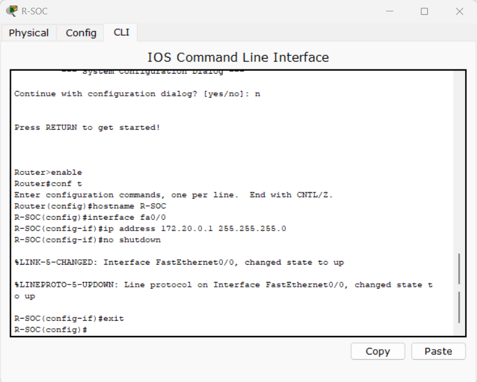

S'està establint el nom de l'encaminador com a R-SOC, s'assigna l'adreça IP 172.20.0.1 amb màscara 255.255.255.0 a la interfície FastEthernet0/0 i s'activa la interfície mitjançant la comanda 'no shutdown'.

</div>
  
```bash
enable
conf t
hostname R-SOC
interface fa0/0
address 172.20.0.1 255.255.255.0
no shutdown
exit
```

---

<div align="center">

### 📡 Configuració de la interfície LAN i del servidor DHCP del router R-SOC

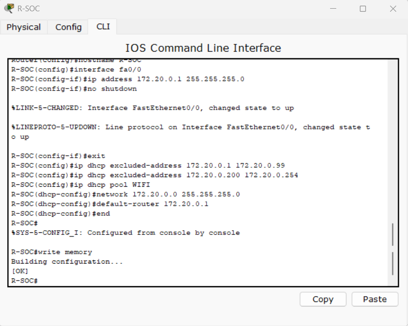

Configurem la interfície FastEthernet0/0 amb l'adreça IP 172.20.0.1/24, l'activem amb `no shutdown` i configurem el servei DHCP per assignar adreces IP automàticament als dispositius de la xarxa Wi-Fi, reservant els rangs d'adreces excloses i establint la passarel·la predeterminada.

</div>

```bash
dhcp excluded-address 172.20.0.1 172.20.0.99
dhcp escluded-address 172.20.0.200 172.20.0.254
dhcp pool WIFI
network 172.20.0.0 255.255.255.0
default router 172.20.0.1
end
write memory
```

---

<div align="center">

### 🔌 Configuració de la interfície VLAN 1 de l'switch SW-SOC

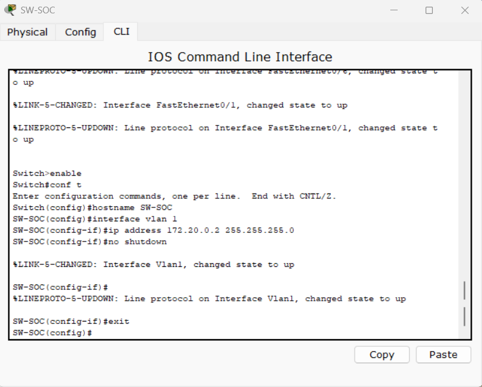

Assignem el nom SW-SOC a l'switch i configurem la interfície virtual VLAN 1 amb l'adreça IP 172.20.0.2/24. Finalment, activem la interfície amb la comanda `no shutdown` per permetre la comunicació i facilitar l'administració de l'switch dins de la xarxa del SOC.

</div>

```bash
enable
conf t
hostname SW-SOC
interface vlan 1
address 172.20.0.2 255.255.255.0
no shutdown
exit
```

---

<div align="center">

### 🔌 Configuració de la interfície de xarxa i gateway al Switch SW-SOC

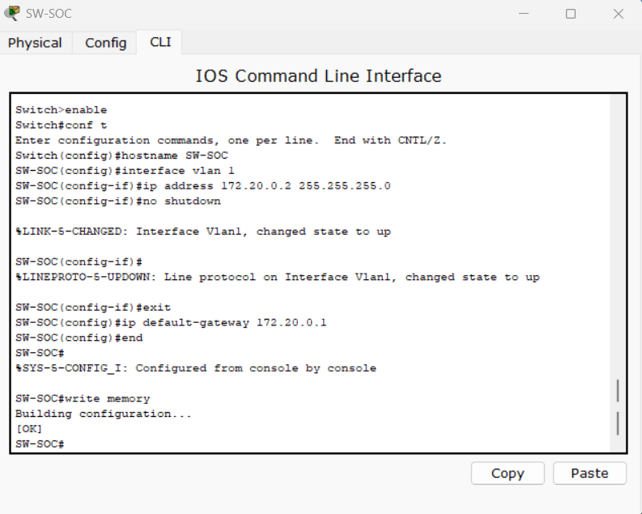

"S'està assignant l'adreça IP 172.20.0.2/24 a la interfície VLAN 1 del switch SW-SOC, s'activa la interfície amb 'no shutdown', es configura la porta d'enllaç predeterminada (172.20.0.1) i es desden en la memòria NVRAM els canvis realitzats."

</div>

```bash
ip default-gateway 172.20.0.1
end
write memory
```

---

<div align="center">

### 🔌 Configuració d'adreça IP estàtica al servidor EMULACIO

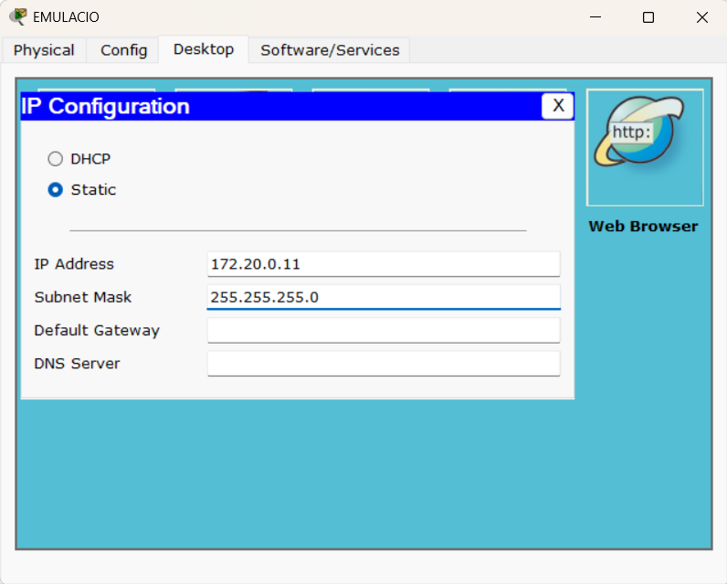

"S'està establint una adreça IP estàtica 172.20.0.11 amb màscara de xarxa 255.255.255.0 al servidor d'EMULACIÓ."

</div>

---

<div align="center">

### 🔌 Configuració d'adreça IP estàtica al servidor de SANDBOX

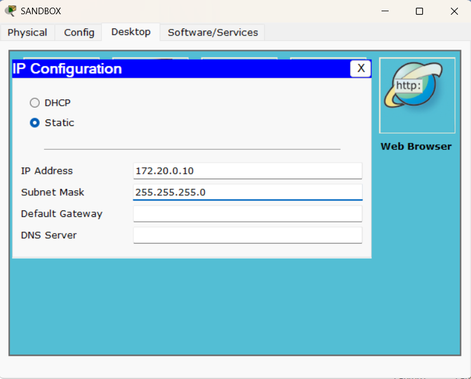

"S'està assignant l'adreça IP estàtica 172.20.0.10 i la màscara 255.255.255.0 al servidor SANDBOX."

</div>

---

<div align="center">

### 🔌 Configuració IP estàtica al PC1

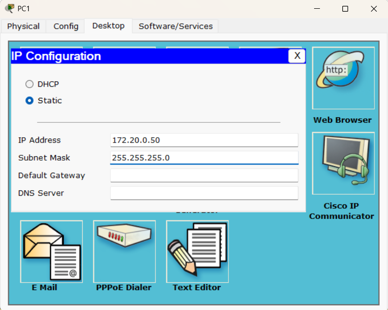

"Es configura la direcció IP estàtica 172.20.0.50 amb màscara de xarxa 255.255.255.0 a l'ordinador PC1."

</div>

---

<div align="center">

### 🔌 Configuració IP estàtica al PC2

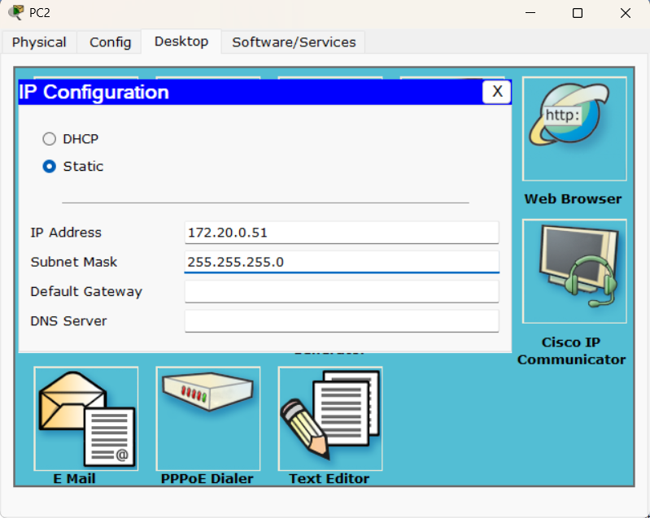

"Es defineix la configuració d'IP estàtica per al PC2 amb l'adreça 172.20.0.51 i màscara 255.255.255.0."

</div>

---

<div align="center">

### 🔌 Configuració IP estàtica al PC3


"S'assigna l'adreça IP estàtica 172.20.0.52 i la màscara de xarxa 255.255.255.0 a l'equip PC3."

</div>

---

<div align="center">

### 🔌 Visualització física del mòdul sense fil a Laptop1

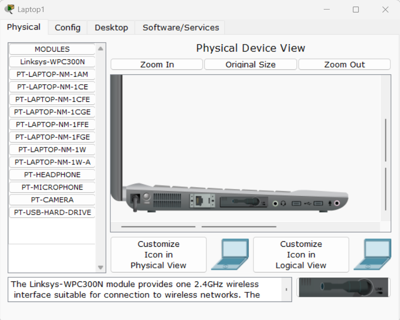

"Canviem l'adaptador de xarxa per cable dels portàtils per una targeta de xarxa inal·làmbrica"

</div>

---

<div align="center">

### 🔌 Cerca de xarxes sense fil disponibles a Laptop1

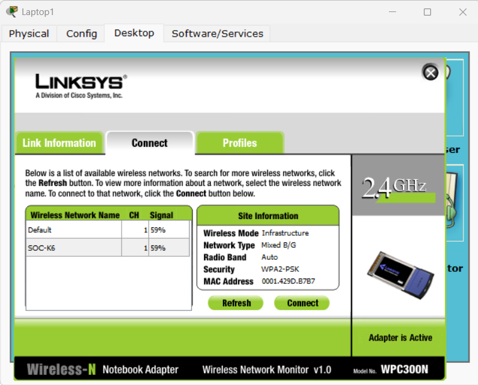

"S'està escanejant l'entorn Wi-Fi des de Laptop1 mitjançant el gestor Wireless Network Monitor, on es detecta la xarxa sense fil 'SOC-K6' al canal 1 amb seguretat WPA2-PSK."

</div>

---

<div align="center">

### 🔌 Introducció de la clau WPA2-Personal a Laptop1

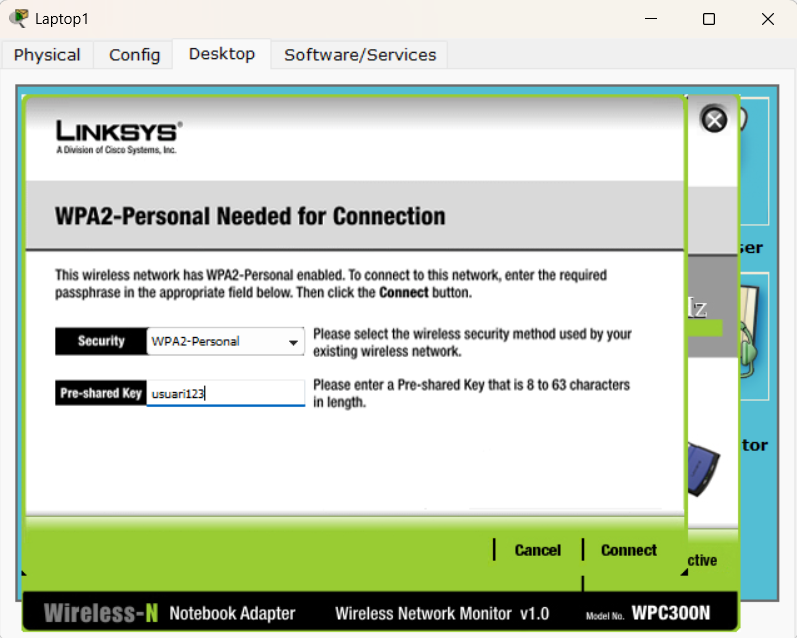

"S'està introduint la contrasenya de seguretat ('usuari123') amb tipus d'autenticació WPA2-Personal per connectar Laptop1 a la xarxa Wi-Fi seleccionada."

</div>

---

<div align="center">

### 🔌 Obtenció d'adreça IP per DHCP a Laptop1

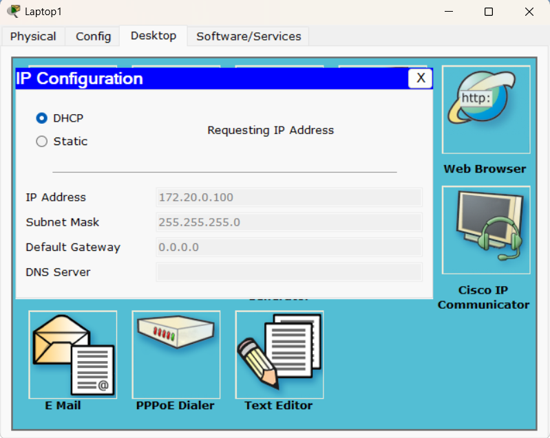

"S'està sol·licitant i registrant automàticament l'adreça IP via DHCP (172.20.0.100/24) a l'equip Laptop1."

</div>

---

<div align="center">

### 🔌 Configuració IP per DHCP a Laptop2

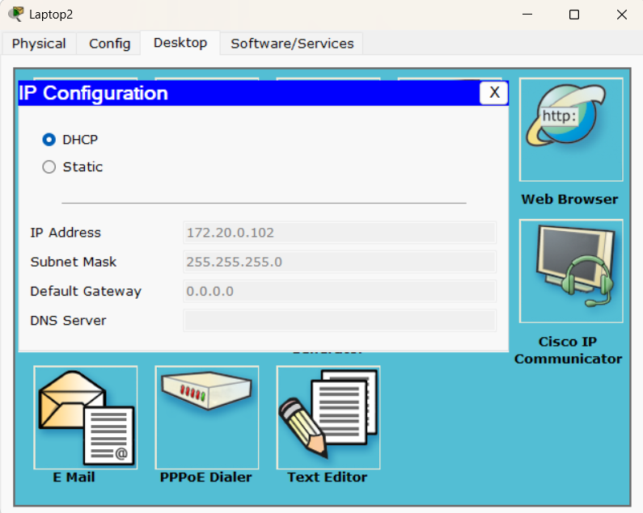

"S'està obtenint l'adreça IP dinàmica per DHCP (172.20.0.102/24) al portàtil Laptop2."

</div>

---

<div align="center">

### 🔌 Configuració IP per DHCP a Laptop3

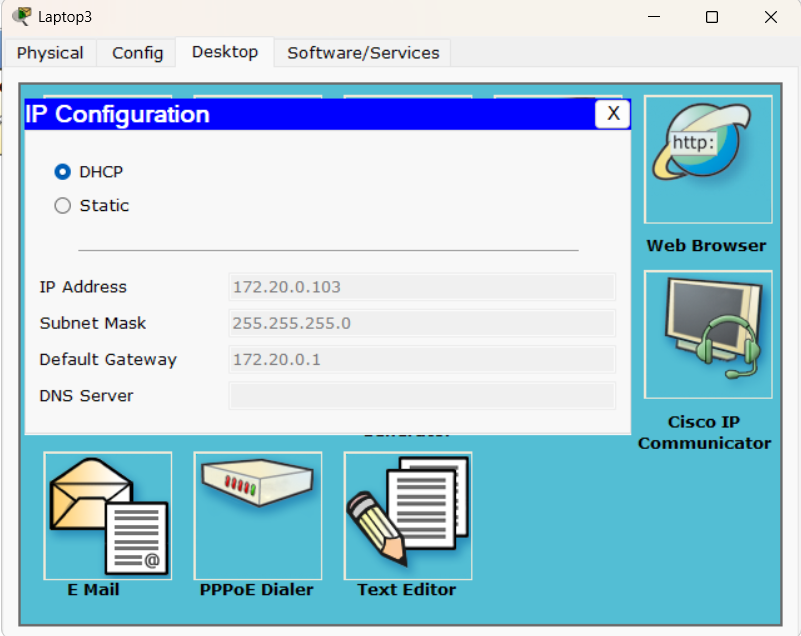

"S'està confirmant la configuració IP automàtica via DHCP a Laptop3, obtenint la direcció 172.20.0.103 i la porta d'enllaç 172.20.0.1."

</div>

---

<div align="center">

### 🔌 Prova de connectivitat (Ping) des del servidor SANDBOX cap a EMULACIO

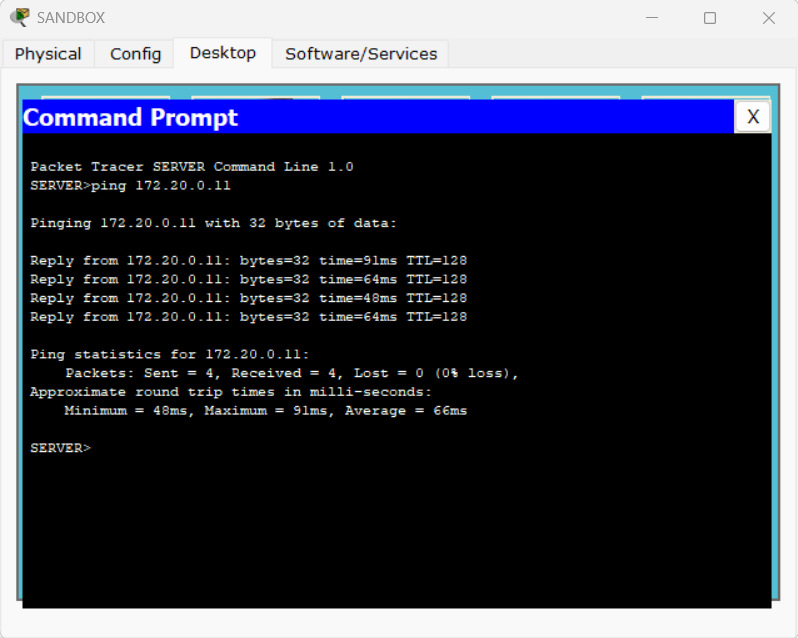

"S'executa la comanda 'ping 172.20.0.11' des de la consola del servidor SANDBOX per verificar que hi ha connectivitat correcta amb el servidor d'EMULACIO (0% de pèrdua de paquets)."

</div>

---

<div align="center">

### 🔌 Configuració del punt d'accés AP1

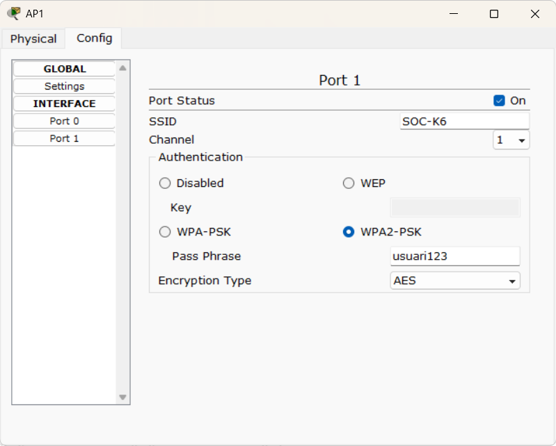

"Es configura el port 1 del punt d'accés AP1 assignant l'SSID 'SOC-K6' al canal 1, amb seguretat WPA2-PSK i xifratge AES utilitzant la contrasenya 'usuari123'."

</div>

---

<div align="center">

### 🔌 Configuració del punt d'accés AP2

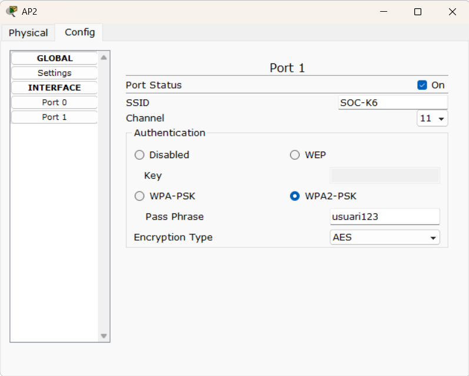

"Es defineix la configuració del punt d'accés AP2 amb el mateix SSID 'SOC-K6' i clau WPA2-PSK, però utilitzant el canal 11 per evitar interferències."

</div>

---

<div align="center">

### 🔌 Prova de connectivitat des de PC1 cap a la Gateway

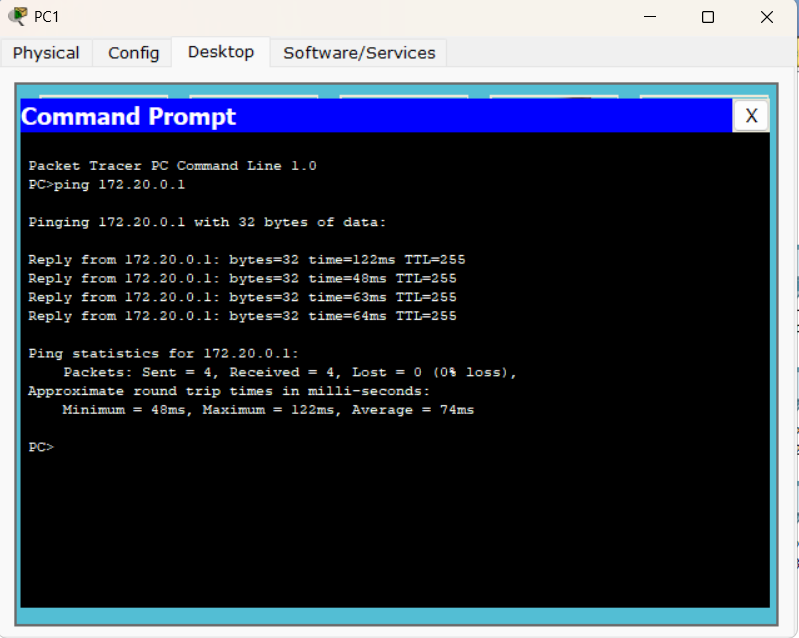

"S'executa un ping des de PC1 cap a la porta d'enllaç (172.20.0.1) des de la consola de comandes, obtenint una resposta satisfatòria de tots els paquets enviats."

</div>

---

<div align="center">

### 🔌 Prova de connectivitat des de Laptop2 cap a SANDBOX

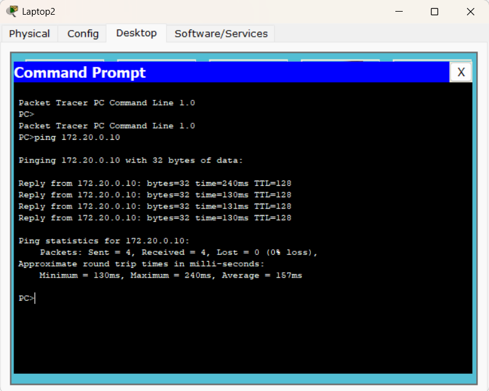

"S'efectua una comprovació de xarxa mitjançant la comanda 'ping 172.20.0.10' des de Laptop2 per validar la comunicació sense fil cap al servidor SANDBOX."

</div>

---

<div align="center">

### 🔌 Filtrat de protocols en el mode simulació

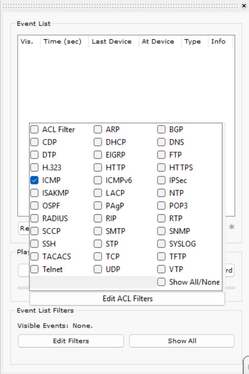

"S'està configurant el filtre de llista d'esdeveniments en el mode simulació per capturar únicament el tràfic de protocol ICMP (ping)."

</div>

---

<div align="center">

### 🔌 Traça de paquets ICMP en la llista d'esdeveniments

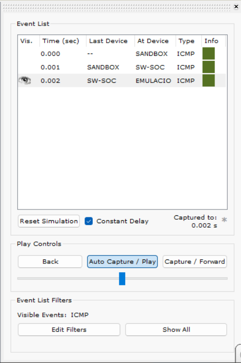

"Es mostra el seguiment pas a pas de la simulació de paquets ICMP viatjant des del servidor SANDBOX cap al switch SW-SOC i la seva destinació a EMULACIO."

</div>

---

<div align="center">

### 🔌 Detalls de la PDU segons el model OSI al dispositiu SANDBOX

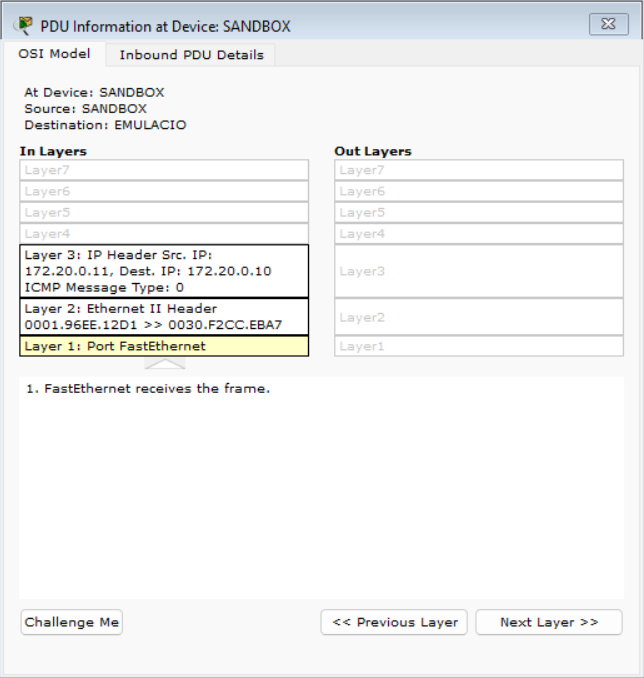

"S'analitza la informació de la PDU d'entrada al dispositiu SANDBOX, mostrant les capes del model OSI (Capa 1 FastEthernet, Capa 2 Ethernet II i Capa 3 IP amb origen 172.20.0.11 i destinació 172.20.0.10)."

</div>

---

<div align="center">

### 🔌 Topologia general de la xarxa en Cisco Packet Tracer

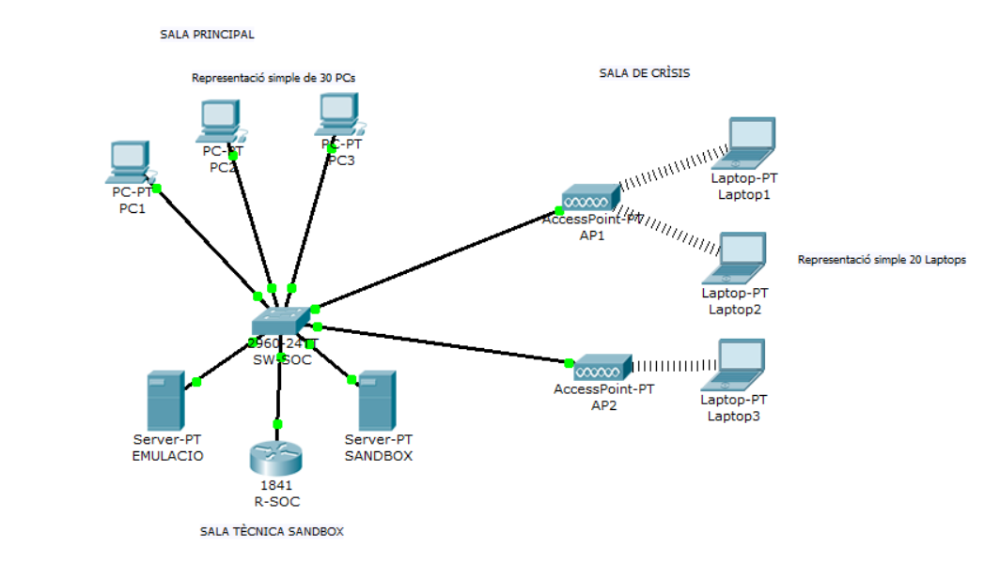

"S'observa el esquema complet de la xarxa dividit en les diferents àrees (Sala Principal, Sala de Crisi i Sala Tècnica Sandbox), connectant els ordinadors, ordinadors portàtils, punts d'accés Wi-Fi, servidors, el switch central SW-SOC i el encaminador R-SOC."

</div>

---

<h2 align="center">✅ RESUM DE LES EVIDÈNCIES</h2>

<p align="center">
  Les captures recollides documenten visualment el desenvolupament de la pràctica, la topologia de xarxa i les configuracions realitzades amb Cisco Packet Tracer.
</p>

---

<a id="fases-practiques"></a>

<h2 align="center">🔧 06 · FASES PRÀCTIQUES</h2>

### 🧪 Fase 4. Resolució d'incidències

Aquesta fase es resol presencialment a la taula d'orientació, seguint les indicacions de la pràctica.

### 🪛 Fase 5. Elaboració d'un cable Ethernet

La pràctica es duu a terme al taller. Per connectar directament dos ordinadors, el muntatge indicat és un cable creuat: un extrem amb l'estàndard **T568A** i l'altre amb **T568B**.

---

<a id="conclusio"></a>

<h2 align="center">✅ 07 · CONCLUSIÓ</h2>

Hem plantejat una LAN en estrella per al SOC de K-SIX Solutions, amb un switch gestionable de 48 ports, cablejat Cat6/Cat6A, dos punts d'accés per als portàtils i un pla d'adreçament dins de `172.20.0.0/24`. També hem definit un pool DHCP separat de les adreces estàtiques i explicat com s'encapsulen les dades quan el servidor Sandbox es comunica amb el servidor d'emulació.

El disseny deixa marge per ampliar el nombre de dispositius i diferencia les necessitats de connexió dels ordinadors d'usuari i del servidor Sandbox.

<div align="center">

**K-SIX SOLUTIONS**  
*Planificació i configuració de la LAN del SOC corporatiu*

</div>

---

<!-- ==================== PEU DEL PROJECTE ==================== -->

<p align="center">
  
  
  
</p>

<p align="center">
  <strong>K-SIX SOLUTIONS</strong><br/>
  <sub>Projecte acadèmic · Planificació i configuració de xarxes</sub>
</p>
