<p align="center">
  
</p>

<p align="center">
  <strong>0376 · CLICKBAIT A LA INTRANET HARDENING WEB</strong>
</p>

<p align="center">
  
  
  
  
</p>

<p align="center">
  <strong>MEMÒRIA TÈCNICA · INFORMES DE LES TRES FITES</strong>
</p>

<p align="center">
  <a href="README.md">
    
  </a>
</p>

---

## 🎯 INFORMACIÓ DEL PROJECTE

**Projecte:** Northstar SOC – Laboratori de ciberseguretat

**Entorn:** Ubuntu Server i Windows 10

**Objectiu general:** Desenvolupar un laboratori controlat que permeti simular esdeveniments de ciberseguretat, recopilar telemetria i verificar-ne el registre mitjançant serveis web, bases de dades i registres del sistema.

---

# 🖥️ FITA 1 · DESPLEGAMENT DE LA INFRAESTRUCTURA DEL LABORATORI SOC

## 1.1. Objectiu

La primera fita consisteix a preparar la infraestructura principal del projecte Northstar SOC, desplegant un servidor Ubuntu que serveixi com a base per als serveis web, l’emmagatzematge de dades i les futures proves de ciberseguretat.

L’objectiu és disposar d’un entorn funcional, centralitzat i controlat, que permeti desenvolupar les aplicacions i simulacions de les fites posteriors.

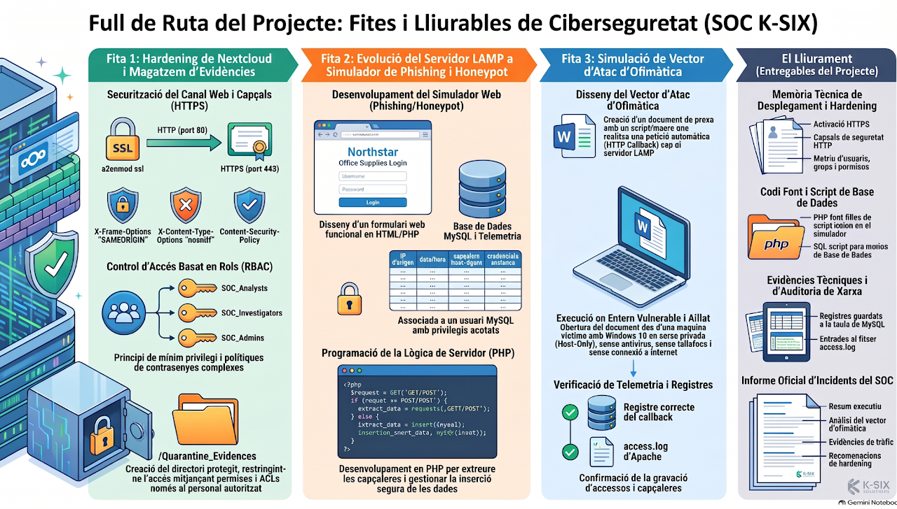

## 1.2. Desenvolupament

En aquesta fase s’ha preparat un servidor amb Ubuntu Server i s’han configurat els serveis necessaris per proporcionar una infraestructura de tipus LAMP.

Els principals components treballats són:

- **Ubuntu Server:** sistema operatiu principal del servidor.

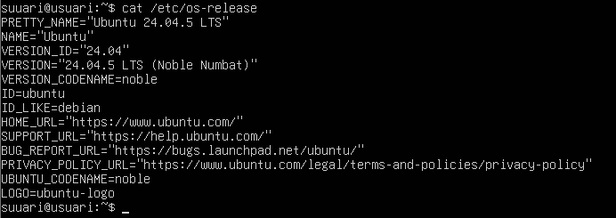

- **Apache:** servidor web encarregat de gestionar les peticions HTTP i HTTPS.

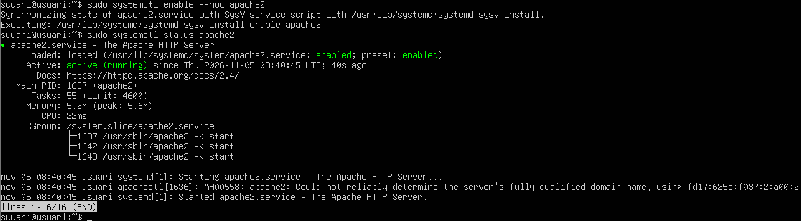

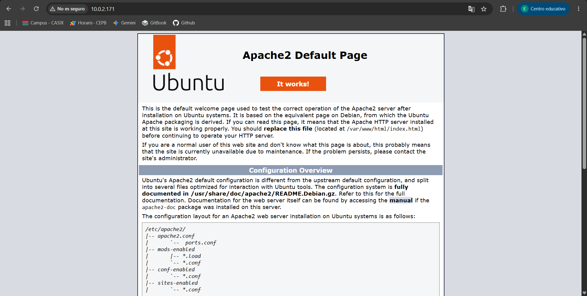

- **PHP:** llenguatge utilitzat per desenvolupar les aplicacions web del projecte.

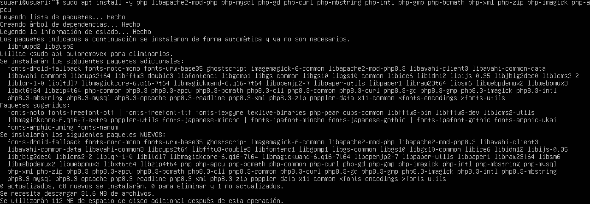

- **MariaDB:** sistema gestor de bases de dades per emmagatzemar la informació generada.

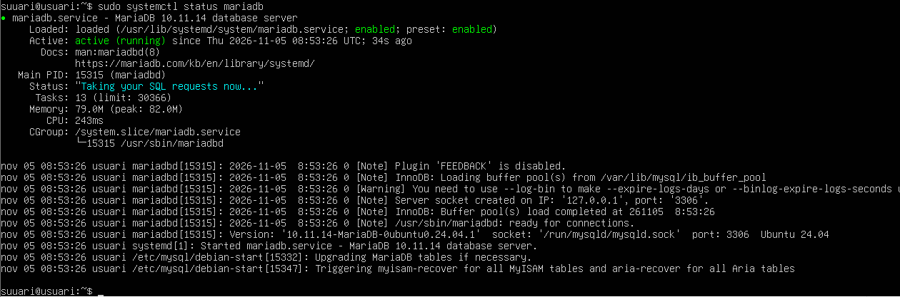

- **Nextcloud:** plataforma d’emmagatzematge i gestió de fitxers.

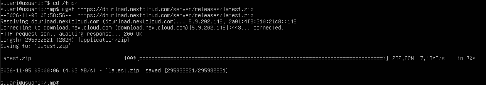

També s’ha treballat en la configuració de l’accés segur als serveis, incloent-hi HTTPS, les capçaleres de seguretat i la gestió d’usuaris i permisos.

La infraestructura s’ha preparat per permetre la comunicació amb altres equips del laboratori, especialment amb una màquina Windows 10 que actua com a equip de proves.

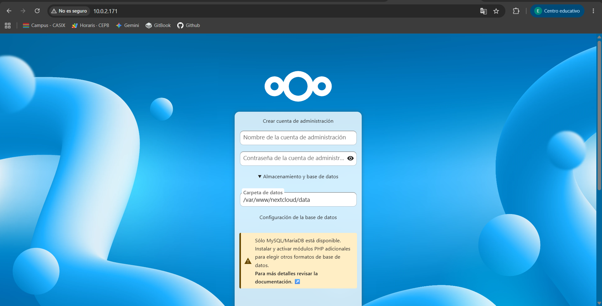

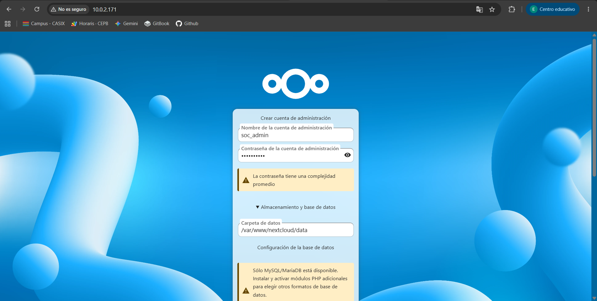

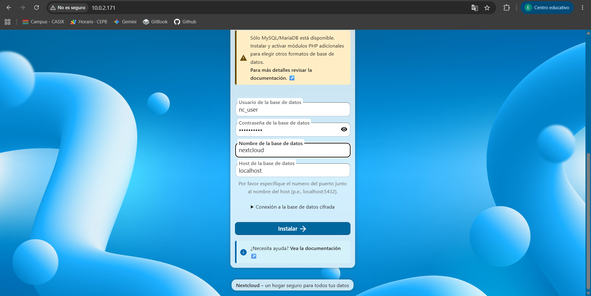

## 1.3. Resultat obtingut

S’ha establert la infraestructura principal del laboratori Northstar SOC, disposant d’un servidor Ubuntu amb els serveis necessaris per allotjar aplicacions web, gestionar dades i proporcionar emmagatzematge.

Aquesta infraestructura constitueix la base sobre la qual s’han desenvolupat les aplicacions de monitoratge i simulació de les fites següents.

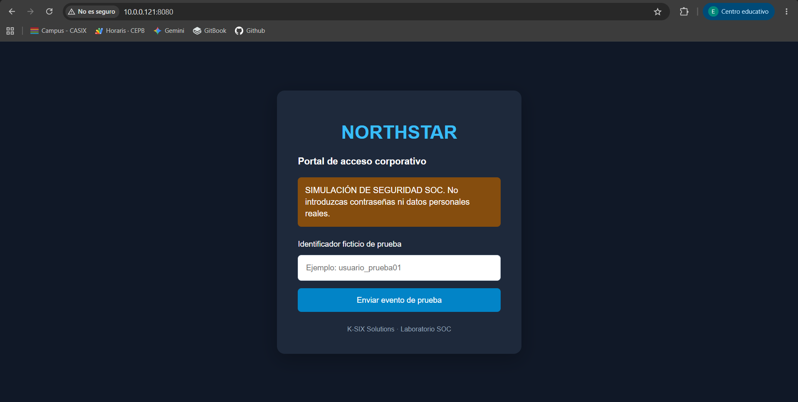

## 1.4. Conclusió

La primera fita permet disposar d’un entorn servidor funcional i preparat per continuar amb el desenvolupament del projecte. La instal·lació dels serveis principals proporciona la base tecnològica necessària per implementar les funcionalitats de registre d’esdeveniments i recopilació de telemetria.

---

# 🌐 FITA 2 · DESENVOLUPAMENT DE L’APLICACIÓ DE SIMULACIÓ I REGISTRE D’ESDEVENIMENTS

## 2.1. Objectiu

La segona fita té com a objectiu desenvolupar una aplicació web que permeti simular esdeveniments de ciberseguretat i registrar-ne la informació en una base de dades.

L’aplicació forma part del laboratori Northstar SOC i permet comprovar com es poden recopilar dades procedents de peticions HTTP i emmagatzemar-les per a una posterior anàlisi.

## 2.2. Desenvolupament

Per implementar aquesta funcionalitat s’ha utilitzat la infraestructura LAMP desplegada durant la primera fita.

S’ha configurat un entorn web específic per al projecte Northstar mitjançant Apache, amb un VirtualHost que escolta pel port 8080.

La configuració principal utilitzada és:

- **Servidor web:** Apache.
- **Port d’accés:** 8080.
- **Llenguatge de programació:** PHP.
- **Sistema gestor de bases de dades:** MariaDB.
- **Base de dades:** `soc_honeypot`.
- **Taula d’esdeveniments:** `eventos`.

S’ha desenvolupat un portal web en PHP que permet gestionar simulacions i enviar informació al servidor mitjançant peticions HTTP.

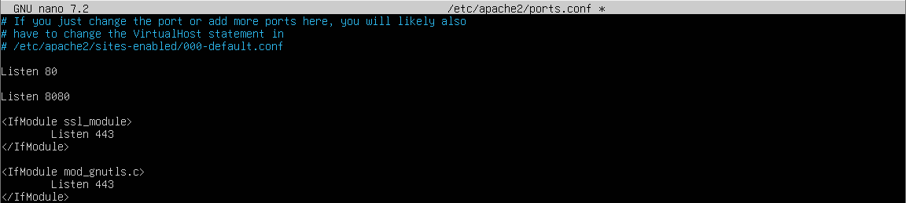

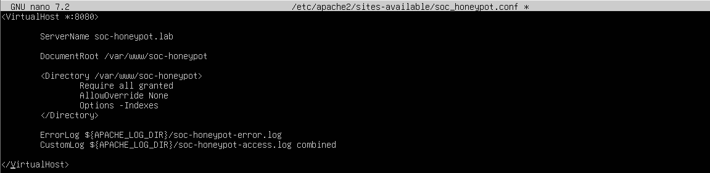

També s’ha preparat el sistema de registre perquè les dades generades per les proves es puguin emmagatzemar a MariaDB.

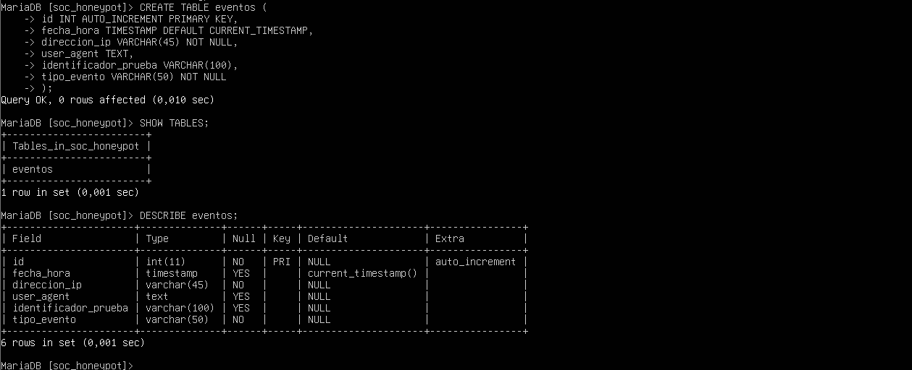

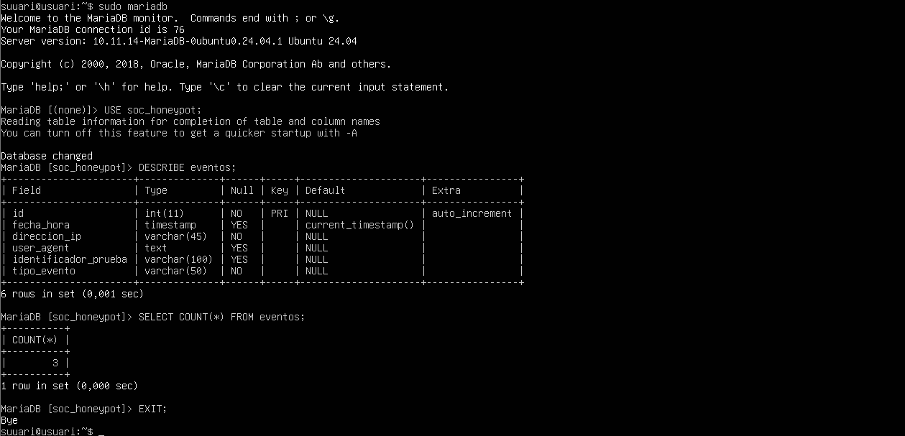

Durant el desenvolupament s’han revisat els errors de connexió entre PHP i MariaDB, així com els problemes relacionats amb les consultes SQL i el registre de les dades.

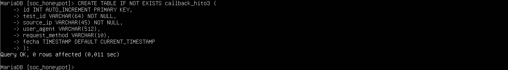

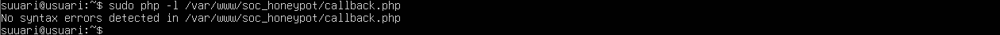

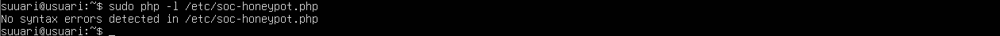

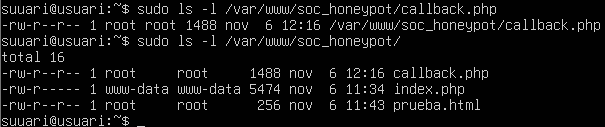

A més, s’han utilitzat els registres específics d’Apache per facilitar la detecció i resolució d’errors durant les proves.

## 2.3. Registre i monitoratge

La base de dades `soc_honeypot` centralitza la informació generada per les simulacions.

La taula `eventos` forma part de l’estructura destinada a emmagatzemar els esdeveniments del laboratori.

Els registres d’Apache permeten consultar les peticions rebudes i identificar possibles errors en el funcionament de l’aplicació.

La configuració específica del portal es troba a:

`/etc/apache2/sites-available/soc_honeypot.conf`


Els registres específics del portal inclouen:

- `/var/log/apache2/soc-honeypot-access.log`
- `/var/log/apache2/soc-honeypot-error.log`

## 2.4. Resultat obtingut

S’ha desenvolupat i configurat el portal web Northstar SOC sobre Apache i PHP, connectat amb la base de dades MariaDB.


S’ha establert l’estructura de dades necessària per gestionar els esdeveniments i s’han preparat els mecanismes de registre i diagnòstic del servidor.

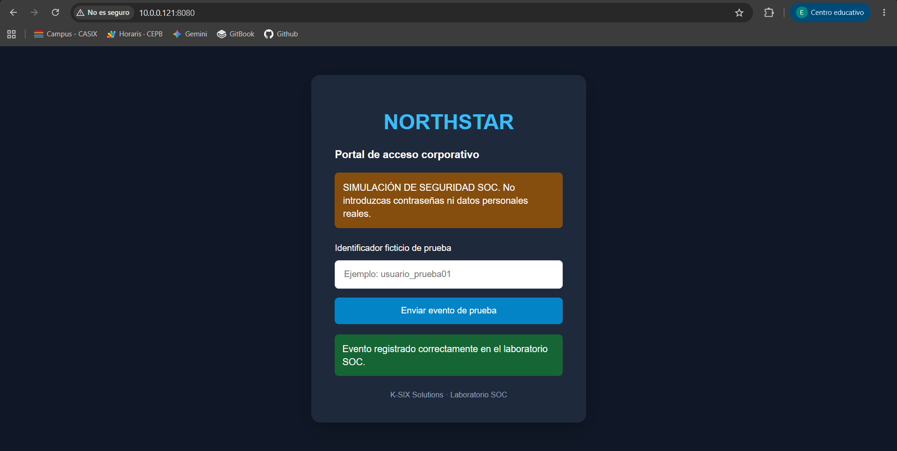

Aquesta fita proporciona el component d’aplicació i emmagatzematge necessari per a les proves de comunicació i recopilació de telemetria de la tercera fita.

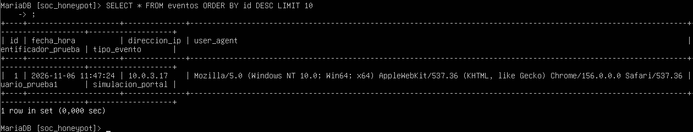

## 2.5. Conclusió

La segona fita permet disposar d’una aplicació web integrada amb una base de dades, preparada per rebre i gestionar informació procedent de les simulacions del laboratori.

La integració entre Apache, PHP i MariaDB constitueix el nucli de registre d’esdeveniments del projecte Northstar SOC.

---

# 📡 FITA 3 · SIMULACIÓ D’UN VECTOR D’ATAC D’OFIMÀTICA I VERIFICACIÓ DE TELEMETRIA

## 3.1. Objectiu

La tercera fita té com a objectiu simular una comunicació originada des d’un document ofimàtic de Microsoft Word cap a l’aplicació PHP del servidor Northstar SOC.

La finalitat és comprovar que el servidor pot rebre una petició HTTP procedent d’un equip Windows 10, processar-la i registrar-ne la informació tant a la base de dades MariaDB com als registres d’Apache.

## 3.2. Preparació de l’entorn

Per dur a terme aquesta simulació s’han utilitzat dos equips:

- **Equip servidor:** Ubuntu Server amb Apache, PHP i MariaDB.
- **Equip de proves:** Windows 10 amb Microsoft Word.

La comunicació s’ha realitzat a través de la xarxa privada del laboratori.

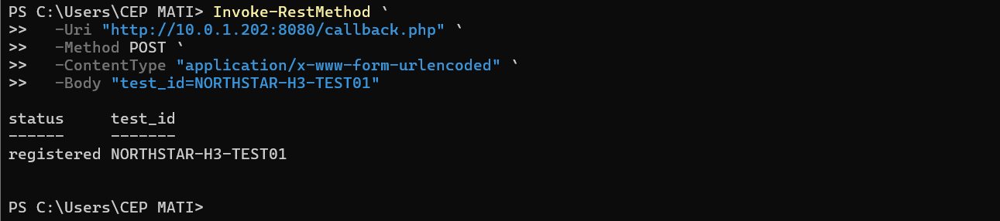

Les dades de connexió utilitzades durant la prova són:

| Paràmetre | Valor |
|---|---|
| Servidor Ubuntu | `10.0.1.202` (Aquesta IP ha hanat canviant durant la pràctica ja que s’estava utilitzant una xarxa inal·làmbrica, en aquest cas s’hauria de configurar una IP) |
| Port | `8080` |
| Endpoint PHP | `/callback.php` |
| URL | `http://10.0.1.202:8080/callback.php` |
| Mètode HTTP | POST |
| Base de dades | `soc_honeypot` |
| Taula | `callback_hito3` |

## 3.3. Creació del document ofimàtic

S’ha utilitzat un document de Microsoft Word anomenat `incidencies`, desat en format `.docm` per permetre la incorporació de macros VBA.

Dins del document s’ha creat un mòdul VBA amb una macro denominada:

`EnviarCallback`

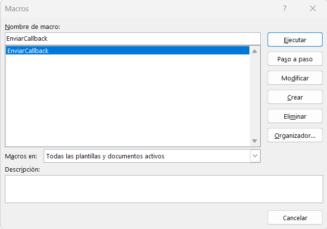

Aquesta macro està dissenyada per enviar una petició HTTP POST a l’endpoint PHP del servidor.

La informació enviada inclou un identificador de prova:

`NORTHSTAR-H3-001`

També s’ha incorporat una capçalera HTTP personalitzada:

`X-Lab-ID: NORTHSTAR-H3-001`

La macro mostra el resultat de la petició a través d’un missatge de Word, de manera que es pot comprovar si la comunicació s’ha realitzat correctament.

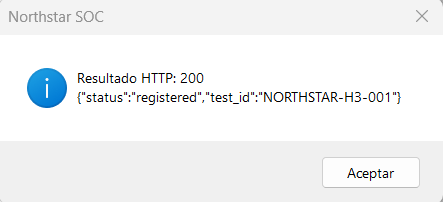

## 3.4. Execució de la simulació

La prova s’ha executat des de Microsoft Word al sistema Windows 10.

La macro s’ha iniciat manualment des del menú de macros de Word, seleccionant `EnviarCallback` i executant-la.

Durant l’execució, el document ha enviat una petició POST al servidor Ubuntu, que ha rebut la informació mitjançant l’endpoint `callback.php`.

El servidor ha processat la petició i ha retornat una resposta HTTP amb codi:

**HTTP 200 OK**

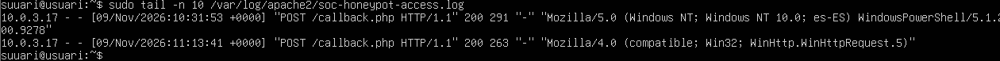

Aquest resultat confirma que la comunicació entre el sistema Windows i l’aplicació PHP del servidor s’ha efectuat correctament.

### 🗄️ 3.5. Verificació a MariaDB

Un cop executada la prova, s’ha accedit a la base de dades `soc_honeypot` per comprovar que la informació havia quedat emmagatzemada.

S’ha consultat la taula:

```text
callback_hito3
```

La consulta utilitzada ha estat:

```sql
SELECT * FROM callback_hito3
LIMIT 10;
```

En els resultats s’ha pogut identificar correctament el registre corresponent a:

```text
NORTHSTAR-H3-001
```

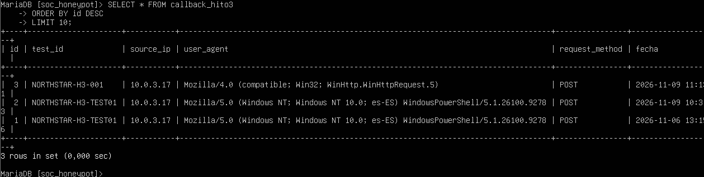

Aquesta comprovació confirma que l’aplicació PHP ha rebut i registrat les dades enviades des del document ofimàtic.

---

### 📊 3.6. Verificació dels registres d’Apache

També s’ha comprovat que Apache havia registrat la petició rebuda.

S’han utilitzat dos fitxers de registre:

**Registre d’accessos:**

```text
/var/log/apache2/soc-honeypot-access.log
```


Aquest fitxer permet consultar informació sobre les peticions rebudes, com ara el mètode HTTP, el recurs sol·licitat i el codi de resposta.

**Registre específic de capçaleres:**

```text
/var/log/apache2/soc-honeypot-headers.log
```

Aquest segon registre s’ha configurat per emmagatzemar també les capçaleres HTTP seleccionades, incloent-hi `Content-Type` i `X-Lab-ID`.

Les comprovacions han permès verificar que la petició POST i les capçaleres corresponents han quedat registrades correctament.

---

### ✅ 3.7. Resultat obtingut

La prova s’ha completat satisfactòriament.

S’han verificat els elements següents:

- Creació del document Word habilitat per a macros.
- Incorporació de la macro VBA `EnviarCallback`.
- Comunicació entre Windows 10 i Ubuntu Server.
- Enviament correcte d’una petició HTTP POST.
- Recepció d’una resposta HTTP 200.
- Emmagatzematge de l’identificador `NORTHSTAR-H3-001` a MariaDB.
- Registre de la petició als fitxers de log d’Apache.
- Registre de les capçaleres HTTP seleccionades.
- [Fitxer PHP](Fitxers/simulador.php)
- [Fitxer SQL](Fitxers/crear_bd.sql)
---

### 🔐 3.8. Adaptació de seguretat respecte de l’enunciat

La simulació s’ha realitzat en un entorn controlat i mantenint les proteccions del sistema operatiu activades.

A diferència del comportament plantejat inicialment a l’enunciat, la macro no s’executa automàticament en obrir el document, sinó que s’inicia manualment des de Word.

Aquesta adaptació permet verificar la comunicació i la recopilació de telemetria sense introduir execució automàtica ni desactivar les proteccions de Windows.

---

### 📝 3.9. Conclusió

La tercera fita ha permès demostrar que un document ofimàtic pot iniciar una comunicació HTTP amb una aplicació web del laboratori SOC i que aquesta informació es pot processar i emmagatzemar correctament.

La verificació conjunta de MariaDB i dels registres d’Apache confirma que el sistema de recopilació de telemetria funciona correctament.

---

# 🏁 CONCLUSIÓ GENERAL DEL PROJECTE NORTHSTAR SOC

Les tres fites desenvolupades permeten construir progressivament un laboratori de ciberseguretat basat en una infraestructura Ubuntu Server, una aplicació web de simulació d’esdeveniments i un sistema de recopilació de telemetria.

La primera fita ha proporcionat la infraestructura tecnològica necessària.

La segona fita ha incorporat l’aplicació web i la base de dades per gestionar els esdeveniments.

Finalment, la tercera fita ha permès verificar una comunicació procedent d’un document ofimàtic, comprovant-ne la recepció, el processament i el registre.

En conjunt, el projecte demostra la integració entre sistemes Windows i Linux, serveis web, llenguatges de programació, bases de dades i mecanismes de registre, reproduint de manera controlada alguns dels processos presents en un entorn de monitoratge SOC.

---

<p align="center">
  <a href="README.md">
    
  </a>
</p>

<p align="center">
  <sub>NORTHSTAR SOC · INFRASTRUCTURE · SIMULATION · MONITORING · TELEMETRY</sub>
</p>
