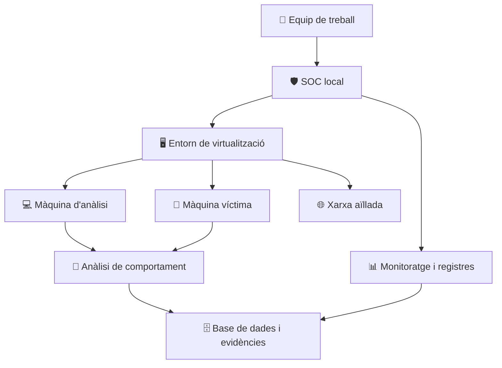

<!-- ==================== CABECERA ==================== -->

<h1 align="center">MALWARE &amp; SANDBOXING</h1>

  <strong>K-SIX SOLUTIONS | CYBERSECURITY LAB</strong>

  ANALYZE · DETECT · PROTECT

  <strong>NAHUEL G · EDU G · MARC J · ALEXIS T</strong>

---

<!-- ==================== INDICE VISUAL ==================== -->

<h2 align="center">🧭 EXPLORAR EL PROJECTE</h2>

  Navega por las diferentes áreas del laboratorio

<table align="center">
  <tr>
    <td align="center">
      
    </td>
    <td align="center">
      
    </td>
    <td align="center">
      
    </td>
  </tr>
  <tr>
    <td align="center">
      
    </td>
    <td align="center">
      
    </td>
    <td align="center">
      
    </td>
  </tr>
  <tr>
    <td align="center">
      
    </td>
    <td align="center">
      
    </td>
    <td align="center">
      
    </td>
  </tr>
  <tr>
    <td align="center">
      
    </td>
    <td align="center">
      
    </td>
    <td align="center">
      
    </td>
  </tr>
</table>

---

<h2 align="center">🎯 SOBRE EL PROJECTE</h2>

  El projecte <strong>Malware i Sandboxing</strong> consisteix a dissenyar i implementar un laboratori de ciberseguretat per estudiar el comportament de programes maliciosos en un entorn controlat, aïllat i recuperable.

  L'objectiu és simular infraestructures informàtiques, monitorar sistemes, analitzar amenaces i documentar els resultats sense posar en risc els equips ni les xarxes reals.

  

  <strong>📊 FITXA DEL PROJECTE</strong>

<table align="center">
  <tr><td align="center"><strong>Àmbit</strong></td><td align="center">Ciberseguretat i sistemes</td></tr>
  <tr><td align="center"><strong>Organització</strong></td><td align="center">K-SIX Solutions</td></tr>
  <tr><td align="center"><strong>Durada estimada</strong></td><td align="center">168 hores</td></tr>
  <tr><td align="center"><strong>Dificultat</strong></td><td align="center">Mitjana</td></tr>
  <tr><td align="center"><strong>Modalitat</strong></td><td align="center">Projecte tècnic en equip</td></tr>
  <tr><td align="center"><strong>Estat</strong></td><td align="center">En desenvolupament</td></tr>
  <tr><td align="center"><strong>Revisió de l'enunciat</strong></td><td align="center">Octubre de 2026</td></tr>
</table>

---

<h2 align="center">🏢 CONTEXT I OBJECTIUS</h2>

  K-SIX Solutions necessita un laboratori on formar tècnics de ciberseguretat i investigar comportaments maliciosos mitjançant proves controlades.

<table>
  <tr>
    <td align="center" width="50%">
      <h3>🖥️ Infraestructura</h3>
      
Creació de màquines virtuals, entorns recuperables i xarxes de laboratori.

    </td>
    <td align="center" width="50%">
      <h3>🦠 Anàlisi de malware</h3>
      
Observació del comportament de les amenaces, monitoratge i anàlisi forense.

    </td>
  </tr>
  <tr>
    <td align="center" width="50%">
      <h3>🌐 Seguretat web</h3>
      
Estudi del phishing, pàgines vulnerables i mesures de hardening.

    </td>
    <td align="center" width="50%">
      <h3>🗄️ Dades i SOC</h3>
      
Registre de resultats, administració de bases de dades i monitoratge.

    </td>
  </tr>
</table>

---

<h2 align="center">🧪 ARQUITECTURA DEL LABORATORI</h2>

  Disseny conceptual de la infraestructura d'anàlisi.

  
  
  
  

  <strong>Nota de seguretat:</strong> el diagrama representa l'arquitectura objectiu, no una infraestructura ja validada. Les proves amb malware requereixen autorització i aïllament adequat.

---

<h2 align="center">⚙️ ÀREES DE TREBALL</h2>

<strong>01 · Virtualització i sistemes operatius</strong>

 
Preparació dels sistemes operatius, configuració de màquines virtuals, instal·lació de programari i creació de punts de recuperació.
  
<strong>Objectiu:</strong> disposar d'entorns funcionals, documentats i recuperables.

<strong>02 · Xarxes i infraestructura del SOC</strong>

 
Disseny de la LAN del laboratori, configuració de la connectivitat i separació dels entorns d'anàlisi.
  
<strong>Objectiu:</strong> construir una infraestructura controlada i documentada.

<strong>03 · Administració de bases de dades</strong>

 
Instal·lació del sistema gestor, disseny de taules, emmagatzematge dels resultats i configuració dels permisos d'accés.
  
<strong>Objectiu:</strong> gestionar les dades de les proves de manera estructurada.

<strong>04 · Phishing i seguretat web</strong>

 
Estudi del phishing, creació d'una pàgina de proves i anàlisi de vulnerabilitats web en un entorn autoritzat.
  
<strong>Objectiu:</strong> entendre els riscos i documentar mesures de protecció.

<strong>05 · Simulació d'atacs i anàlisi forense</strong>

 
Observació d'esdeveniments, identificació de canvis i documentació de les evidències obtingudes.
  
<strong>Objectiu:</strong> elaborar informes que expliquin els resultats de les proves.

<strong>06 · Hardening i Secure by Design</strong>

 
Revisió de configuracions, reducció de la superfície d'atac i incorporació de mesures preventives des del disseny.
  
<strong>Objectiu:</strong> millorar la seguretat de sistemes i aplicacions.

---

<h2 align="center">🚩 REPTES DEL PROJECTE</h2>

<table>
  <tr>
    <td align="center"><strong>01</strong></td>
    <td><strong>Preparació del sandbox</strong> Crear un entorn controlat i recuperable.</td>
  </tr>
  <tr>
    <td align="center"><strong>02</strong></td>
    <td><strong>LAN del SOC corporatiu</strong> Planificar la xarxa del laboratori.</td>
  </tr>
  <tr>
    <td align="center"><strong>03</strong></td>
    <td><strong>Bases de dades</strong> Administrar dades, usuaris i privilegis.</td>
  </tr>
  <tr>
    <td align="center"><strong>04</strong></td>
    <td><strong>Phishing: confiança digital</strong> Estudiar el phishing en un entorn de proves.</td>
  </tr>
  <tr>
    <td align="center"><strong>05</strong></td>
    <td><strong>Clickbait i hardening web</strong> Analitzar continguts web i aplicar proteccions.</td>
  </tr>
  <tr>
    <td align="center"><strong>06</strong></td>
    <td><strong>Simulació d'atacs i anàlisi forense</strong> Documentar canvis i evidències.</td>
  </tr>
  <tr>
    <td align="center"><strong>07</strong></td>
    <td><strong>Challenge: Secure by Design</strong> Incorporar seguretat des del disseny.</td>
  </tr>
  <tr>
    <td align="center"><strong>08</strong></td>
    <td><strong>Disseny d'un laboratori segur</strong> Integrar els components de la infraestructura.</td>
  </tr>
</table>

---

<h2 align="center">🛠️ TECNOLOGIES I EINES</h2>

  

  
  
  
  

  Tecnologies de referència; la seva inclusió no implica que totes estiguin instal·lades o configurades.

---

<h2 align="center">🔐 SEGURETAT I PREVENCIÓ</h2>

<table>
  <tr>
    <td align="center" width="33%">
      <h3>🔒 Aïllament</h3>
      
Separació dels entorns de proves respecte de les xarxes de producció.

    </td>
    <td align="center" width="33%">
      <h3>💾 Recuperació</h3>
      
Màquines virtuals recuperables i còpies de seguretat.

    </td>
    <td align="center" width="33%">
      <h3>📋 Evidències</h3>
      
Registre de proves i documentació dels resultats.

    </td>
  </tr>
</table>

  

  <strong>Cap prova ha de comprometre sistemes, dades o persones alienes al laboratori.</strong>

---

<h2 align="center">📦 LLIURABLES</h2>

<table>
  <tr>
    <td align="center" width="33%">
      <h3>📄</h3>
      <strong>Documentació tècnica</strong>
      
Preparació, proves controlades, monitoratge i anàlisi forense.

    </td>
    <td align="center" width="33%">
      <h3>🗄️</h3>
      <strong>Base de dades</strong>
      
Informació de les proves, estructura i documentació del sistema gestor.

    </td>
    <td align="center" width="33%">
      <h3>🌐</h3>
      <strong>Disseny de xarxa</strong>
      
Esquema de la infraestructura i els seus components.

    </td>
  </tr>
</table>

---

<h2 align="center">👥 EQUIP DE TREBALL</h2>

  

<table align="center">
  <tr>
    <td align="center" width="25%">
      
    </td>
    <td align="center" width="25%">
      
    </td>
    <td align="center" width="25%">
      
    </td>
    <td align="center" width="25%">
      
    </td>
  </tr>
</table>

  La distribució de responsabilitats s'actualitzarà segons l'organització definitiva de l'equip.

---

<h2 align="center">📚 COMPETÈNCIES TREBALLADES</h2>

  
  
  
  
  
  

- **Implantació de sistemes operatius:** instal·lació, configuració i monitoratge.
- **Planificació i administració de xarxes:** infraestructura i connectivitat.
- **Fonaments de maquinari:** configuració d'equips i programari.
- **Gestió de bases de dades:** modelatge i disseny.
- **Llenguatges de marques:** estructura i presentació d'informació web.
- **Administració de sistemes gestors de bases de dades:** configuració i control d'accés.
- **Ciberseguretat i hacking ètic:** detecció i anàlisi d'amenaces.
- **Itinerari personal per l'ocupabilitat I:** prevenció de riscos laborals.

---

<h2 align="center">🌱 SOSTENIBILITAT</h2>

<table align="center">
  <tr>
    <td align="center" width="33%">
      <h3>♻️</h3>
      <strong>Reutilització</strong>
      
Aprofitar maquinari compatible.

    </td>
    <td align="center" width="33%">
      <h3>⚡</h3>
      <strong>Eficiència</strong>
      
Optimitzar recursos mitjançant la virtualització.

    </td>
    <td align="center" width="33%">
      <h3>🛡️</h3>
      <strong>Responsabilitat</strong>
      
Protegir les dades i aplicar pràctiques ètiques.

    </td>
  </tr>
</table>

---

<h2 align="center">📈 SEGUIMENT DEL PROJECTE</h2>

  Llista de control inicial. Actualitza les tasques quan es completin.

- [ ] Preparar l'entorn de virtualització.
- [ ] Configurar i documentar la xarxa.
- [ ] Preparar els sistemes de monitoratge.
- [ ] Configurar el sistema gestor de bases de dades.
- [ ] Desenvolupar l'entorn web de proves.
- [ ] Documentar les proves controlades.
- [ ] Elaborar els informes d'anàlisi forense.
- [ ] Completar el manual de prevenció de riscos laborals.
- [ ] Revisar la documentació i preparar la presentació final.

---

<!-- ==================== PEU ANIMAT ==================== -->

  

  
  
  

  

  <strong>K-SIX SOLUTIONS</strong> 
  Projecte acadèmic de ciberseguretat · Novembre de 2026

