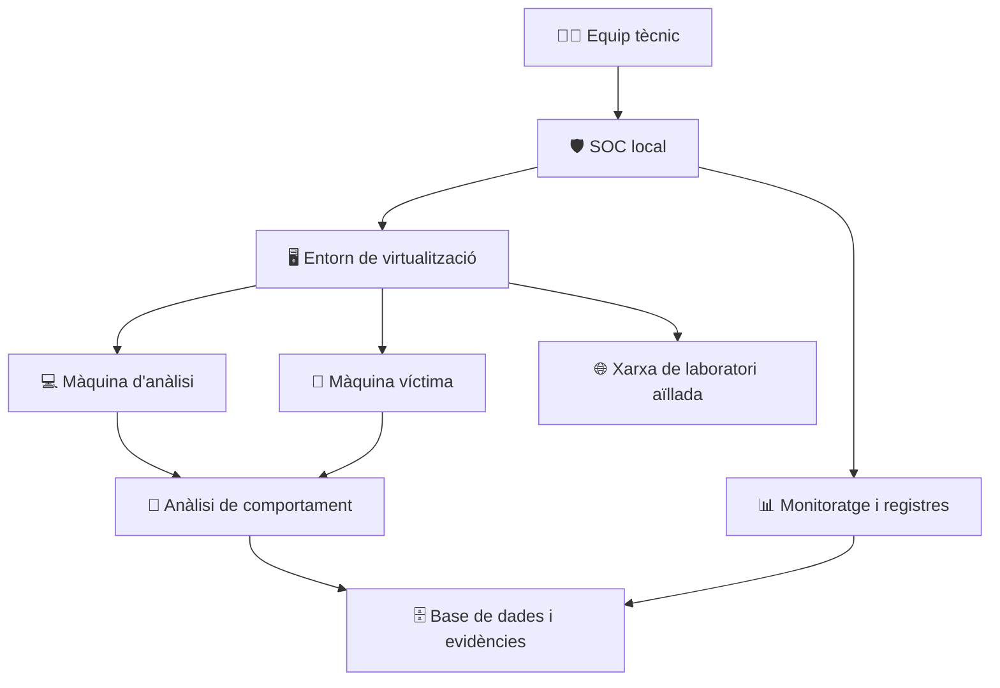

# 🛡️ Malware & Sandboxing Lab

  
  
  

  <strong>Disseny i implementació d'un laboratori controlat d'anàlisi de malware, monitoratge de sistemes i ciberseguretat.</strong>

  
  
  
  
  

---

## 📌 Índex

- [🎯 Sobre el projecte](#-sobre-el-projecte)
- [🏢 Context i objectius](#-context-i-objectius)
- [🧪 Arquitectura del laboratori](#-arquitectura-del-laboratori)
- [⚙️ Àrees de treball](#️-àrees-de-treball)
- [🚩 Reptes del projecte](#-reptes-del-projecte)
- [🛠️ Tecnologies i eines](#️-tecnologies-i-eines)
- [🔐 Seguretat i prevenció](#-seguretat-i-prevenció)
- [📦 Lliurables](#-lliurables)
- [👥 Equip de treball](#-equip-de-treball)
- [📚 Competències treballades](#-competències-treballades)
- [🌱 Sostenibilitat](#-sostenibilitat)
- [📈 Seguiment del projecte](#-seguiment-del-projecte)

---

## 🎯 Sobre el projecte

El projecte **Malware i Sandboxing** consisteix a dissenyar i implementar un laboratori de ciberseguretat per estudiar el comportament de programes maliciosos en un entorn controlat, aïllat i recuperable.

El laboratori permetrà simular infraestructures informàtiques, monitorar sistemes, analitzar amenaces i documentar els resultats sense posar en risc els equips ni les xarxes reals.

> 💡 **Objectiu principal:** construir un entorn de pràctiques que permeti investigar amenaces digitals, entendre'n el comportament i aplicar tècniques de prevenció, detecció i anàlisi forense.

### 📊 Fitxa del projecte

| Característica | Descripció |
|---|---|
| Projecte | Malware i Sandboxing |
| Organització fictícia | K-SIX Solutions |
| Àmbit | Ciberseguretat i administració de sistemes |
| Durada estimada | 168 hores |
| Dificultat | Mitjana |
| Tipus de treball | Projecte tècnic en equip |
| Estat | En desenvolupament |
| Revisió de l'enunciat | Octubre de 2026 |

---

## 🏢 Context i objectius

K-SIX Solutions necessita un laboratori on formar tècnics de ciberseguretat i investigar comportaments maliciosos mitjançant proves controlades.

### Objectius principals

<table>
<tr>
<td width="50%" valign="top">

### 🖥️ Infraestructura

- Crear màquines virtuals operatives.
- Preparar entorns recuperables.
- Dissenyar una xarxa de laboratori.
- Simular sistemes i serveis empresarials.

</td>
<td width="50%" valign="top">

### 🦠 Anàlisi de malware

- Observar el comportament de les amenaces.
- Monitorar canvis al sistema.
- Registrar indicadors i evidències.
- Realitzar anàlisis forenses bàsiques.

</td>
</tr>
<tr>
<td width="50%" valign="top">

### 🌐 Aplicacions web

- Estudiar pàgines vulnerables.
- Analitzar tècniques de phishing.
- Desenvolupar una intranet de proves.
- Aplicar mesures de hardening web.

</td>
<td width="50%" valign="top">

### 🗄️ Dades i monitoratge

- Instal·lar i configurar una base de dades.
- Definir usuaris, rols i privilegis.
- Emmagatzemar els resultats de les proves.
- Organitzar un SOC local.

</td>
</tr>
</table>

---

## 🧪 Arquitectura del laboratori

L'arquitectura proposada es basa en la separació dels sistemes de prova, la supervisió de l'activitat i l'emmagatzematge de les evidències.

### Components principals

- **Virtualització:** creació de màquines independents i recuperables.
- **Sandboxing:** execució de proves dins d'un entorn controlat.
- **Xarxa aïllada:** separació del laboratori respecte de les xarxes reals.
- **Monitoratge:** observació dels processos, serveis, connexions i canvis.
- **Base de dades:** registre estructurat dels experiments.
- **Anàlisi forense:** recollida i estudi d'evidències.

> ⚠️ Les proves amb malware s'han de realitzar únicament amb autorització, mostres controlades i mesures d'aïllament adequades. El diagrama representa una arquitectura objectiu, no una infraestructura ja validada.

---

## ⚙️ Àrees de treball

<strong>01 · Virtualització i sistemes operatius</strong>

Preparació dels sistemes operatius, configuració de les màquines virtuals, instal·lació del programari i creació de punts de recuperació.

**Resultat esperat:** entorns de proves funcionals, documentats i recuperables.

<strong>02 · Xarxes i infraestructura del SOC</strong>

Disseny de la LAN del laboratori, configuració de la connectivitat i separació dels entorns d'anàlisi.

**Resultat esperat:** una xarxa documentada amb una arquitectura segura i controlada.

<strong>03 · Administració de bases de dades</strong>

Instal·lació del sistema gestor, disseny de les taules, emmagatzematge dels resultats i configuració dels permisos d'accés.

**Resultat esperat:** una base de dades documentada per consultar i gestionar les proves realitzades.

<strong>04 · Phishing i seguretat web</strong>

Estudi dels elements que poden generar confiança digital, creació d'una pàgina de proves i anàlisi de les vulnerabilitats web en un entorn autoritzat.

**Resultat esperat:** una aplicació de laboratori documentada i un conjunt de mesures de protecció.

<strong>05 · Simulació d'atacs i anàlisi forense</strong>

Observació dels esdeveniments, identificació dels canvis produïts als sistemes i documentació de les evidències obtingudes.

**Resultat esperat:** informes d'anàlisi que permetin explicar què ha passat i quins indicadors s'han identificat.

<strong>06 · Hardening i Secure by Design</strong>

Revisió de la configuració dels sistemes i aplicacions, reducció de la superfície d'atac i aplicació de mesures preventives des de la fase de disseny.

**Resultat esperat:** una infraestructura amb controls de seguretat documentats.

---

## 🚩 Reptes del projecte

| # | Repte | Finalitat |
|---:|---|---|
| 01 | Preparació del sandbox | Crear un entorn controlat i recuperable. |
| 02 | LAN del SOC corporatiu | Planificar i configurar la xarxa del laboratori. |
| 03 | Bases de dades | Administrar les dades, els usuaris i els privilegis. |
| 04 | Phishing: confiança digital | Estudiar els mecanismes del phishing en un entorn de proves. |
| 05 | Clickbait a la intranet i hardening web | Analitzar continguts web i aplicar mesures de protecció. |
| 06 | Simulació d'un atac i anàlisi forense | Observar els canvis i documentar les evidències. |
| 07 | Challenge: Secure by Design | Incorporar la seguretat des del disseny. |
| 08 | Disseny d'un laboratori segur | Integrar els components en una infraestructura coherent. |

---

## 🛠️ Tecnologies i eines

Les eines concretes es definiran segons els requeriments i les necessitats del laboratori.

  
  
  
  
  

| Àrea | Eines o tecnologies de referència |
|---|---|
| Virtualització | VirtualBox o una alternativa compatible |
| Sistemes operatius | Linux i sistemes convidats de laboratori |
| Xarxes | Adaptadors virtuals, LAN i segmentació |
| Bases de dades | SQL i un sistema gestor compatible |
| Aplicacions web | HTML, CSS i serveis web |
| Anàlisi de seguretat | Eines de monitoratge i anàlisi forense |
| Documentació | Markdown, Git i GitHub |

> ℹ️ Els elements anteriors són tecnologies de referència. No impliquen que totes estiguin instal·lades o configurades.

---

## 🔐 Seguretat i prevenció

La seguretat és un requisit fonamental del laboratori.

- Aïllar els entorns de proves de les xarxes de producció.
- Utilitzar màquines virtuals recuperables i còpies de seguretat.
- Limitar els permisos d'accés segons les responsabilitats.
- Registrar les proves i conservar les evidències.
- Aplicar procediments de prevenció de riscos laborals.
- Respectar la legislació, la privacitat i els principis del hacking ètic.

> **Principi bàsic:** cap prova ha de comprometre sistemes, dades o persones alienes al laboratori.

---

## 📦 Lliurables

### 📄 01 · Documentació tècnica

Documentació del procés de preparació del laboratori, les proves controlades, el monitoratge i l'anàlisi forense.

### 🗄️ 02 · Base de dades

Estructura de les dades de les proves, informació capturada i documentació del sistema gestor.

### 🌐 03 · Disseny de la xarxa

Esquema de la xarxa del laboratori empresarial, els seus components i la seva organització.

---

## 👥 Equip de treball

  <strong>Equip responsable del desenvolupament del projecte</strong>

<table>
<tr>
<td align="center" width="25%">

### 👨‍💻 Nahuel G

Equip tècnic

</td>
<td align="center" width="25%">

### 👨‍💻 Edu G

Equip tècnic

</td>
<td align="center" width="25%">

### 👨‍💻 Marc J

Equip tècnic

</td>
<td align="center" width="25%">

### 👨‍💻 Alexis T

Equip tècnic

</td>
</tr>
</table>

La distribució de responsabilitats s'actualitzarà segons l'organització definitiva de l'equip i els reptes assignats.

---

## 📚 Competències treballades

El projecte integra aprenentatges de diferents mòduls formatius:

- **Implantació de sistemes operatius:** instal·lació, configuració i monitoratge.
- **Planificació i administració de xarxes:** infraestructura i connectivitat.
- **Fonaments de maquinari:** configuració d'equips i programari.
- **Gestió de bases de dades:** modelatge i disseny de dades.
- **Llenguatges de marques:** estructura i presentació d'informació web.
- **Administració de sistemes gestors de bases de dades:** configuració i control d'accés.
- **Ciberseguretat i hacking ètic:** detecció i anàlisi d'amenaces.
- **Itinerari personal per l'ocupabilitat I:** prevenció de riscos laborals.

L'objectiu és combinar coneixements tècnics, treball en equip, documentació i resolució d'incidències en un context professional.

---

## 🌱 Sostenibilitat

- ♻️ Reutilització de maquinari compatible.
- ⚡ Ús eficient dels recursos mitjançant la virtualització.
- 💾 Gestió responsable de l'emmagatzematge i les còpies.
- 🗑️ Eliminació segura de dades quan sigui necessari.
- 🛡️ Prevenció de riscos digitals i protecció de la informació.
- ⚖️ Ús responsable, ètic i legal de les eines de ciberseguretat.

---

## 📈 Seguiment del projecte

L'estat següent és una plantilla inicial de seguiment que s'haurà d'actualitzar a mesura que es completin les activitats.

- [ ] Preparar l'entorn de virtualització.
- [ ] Configurar i documentar la xarxa del laboratori.
- [ ] Preparar els sistemes de monitoratge.
- [ ] Instal·lar i configurar el sistema gestor de bases de dades.
- [ ] Desenvolupar l'entorn web de proves.
- [ ] Documentar les proves controlades.
- [ ] Elaborar els informes d'anàlisi forense.
- [ ] Completar el manual de prevenció de riscos laborals.
- [ ] Revisar la documentació i preparar la presentació final.

---

  
  
  

  <strong>Malware & Sandboxing Lab</strong> 
  Aprendre a detectar, analitzar i prevenir amenaces en un entorn controlat.  
  Projecte acadèmic · K-SIX Solutions · Octubre de 2026

